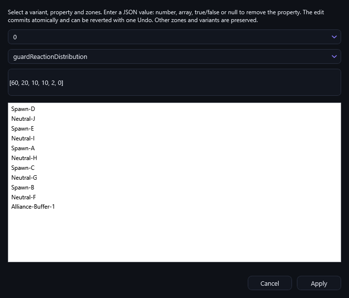
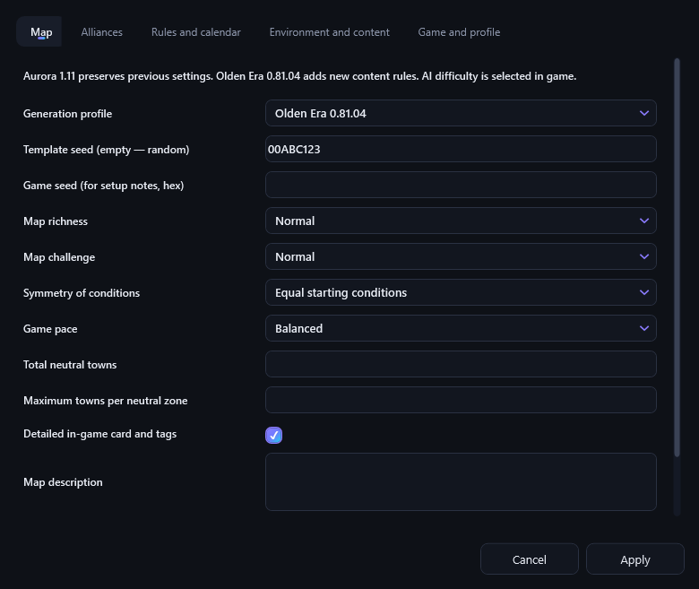
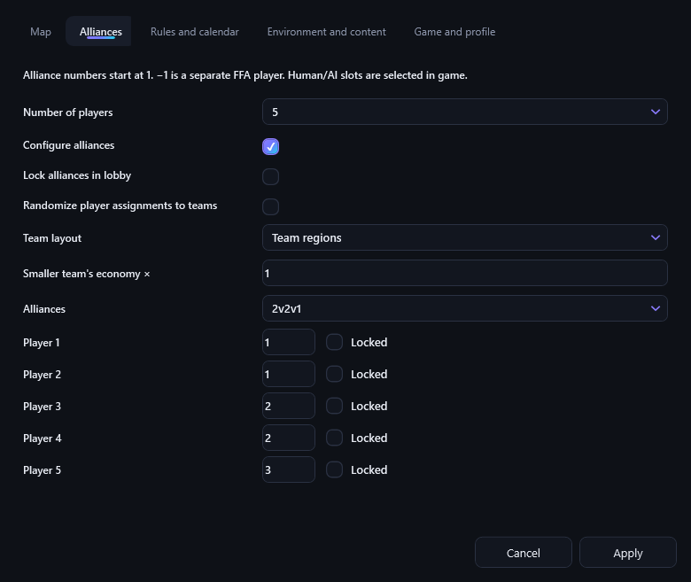
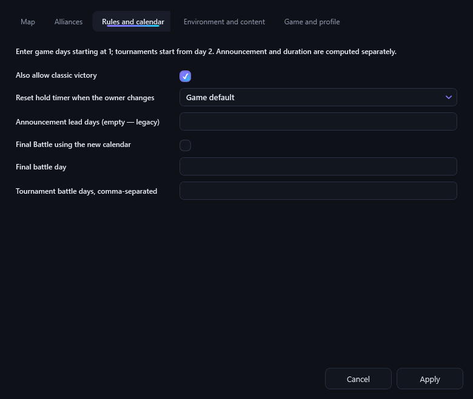
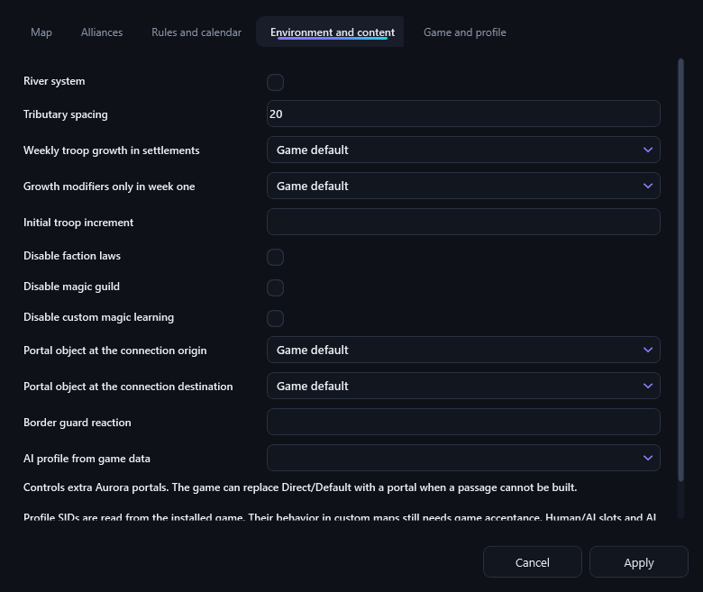
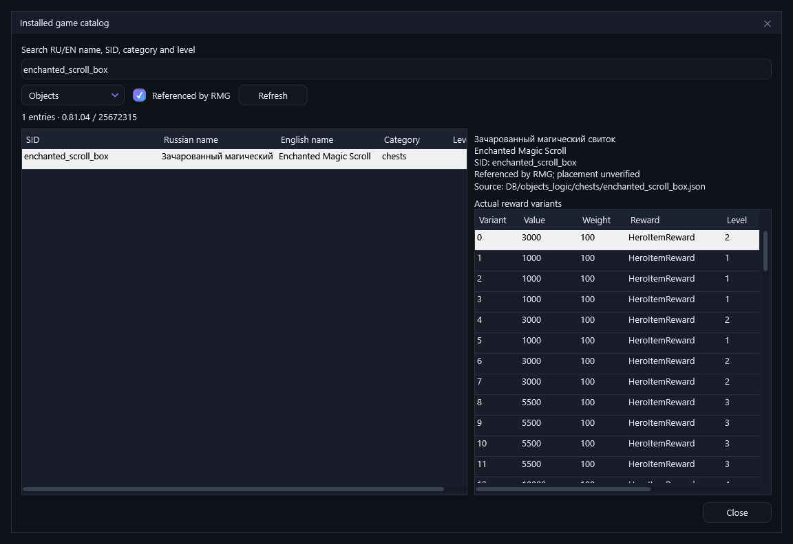
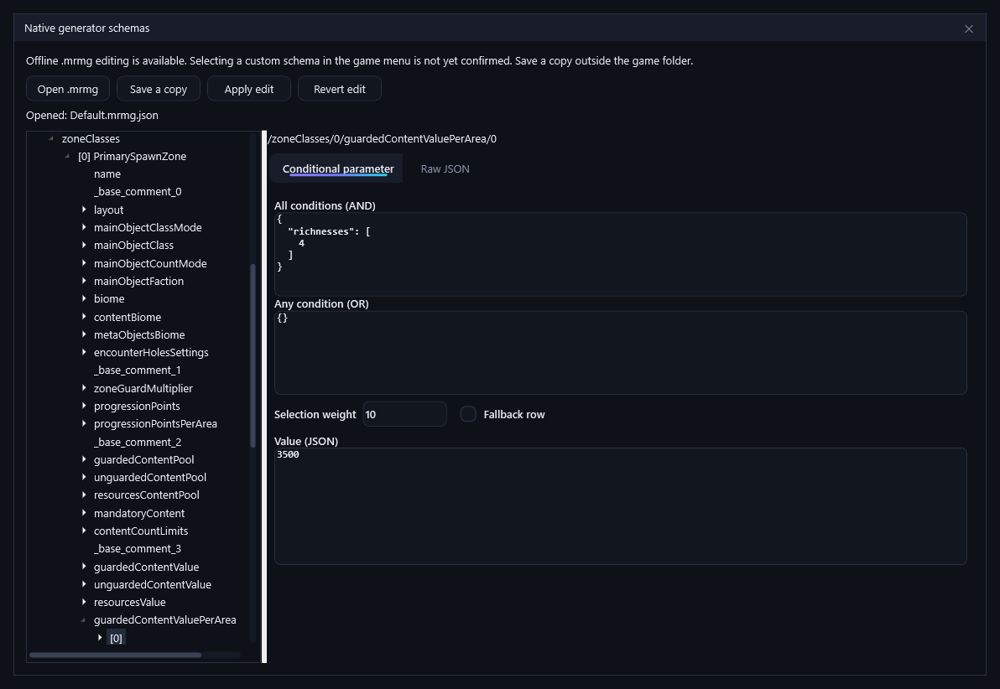
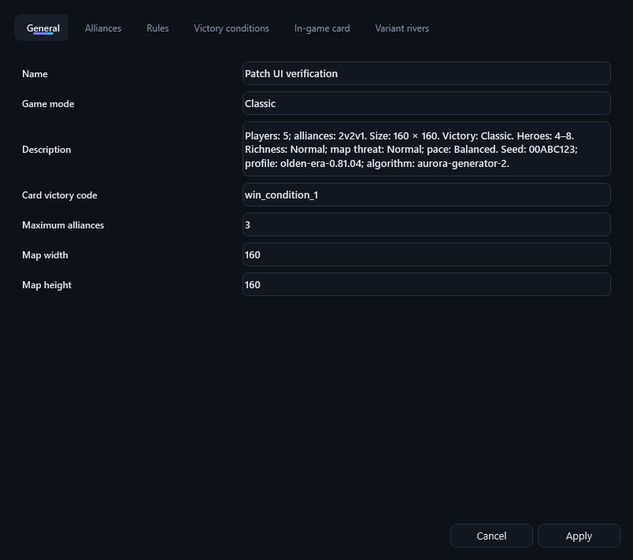
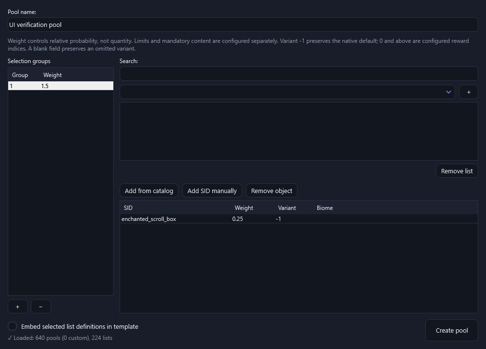

<a id="auroramrg"></a>
<div align="center">


### Random map template generator for **Heroes of Might and Magic: Olden Era**

[](https://github.com/sany86russ/AuroraRMG/releases/latest)
[](https://github.com/sany86russ/AuroraRMG/releases)
[](https://github.com/sany86russ/AuroraRMG/releases/latest)

**Configure your map in a friendly UI instead of hand-editing JSON — then hit "Create template".**

[📥 Download](#-installation) · [🚀 Quick start](#-quick-start) · [🧭 Interface](#-interface-overview) · [⚙️ All settings](#️-all-settings) · [🎲 Presets](#-built-in-presets-53-and-43-legacy) · [❓ FAQ](#-faq)

[Русский](README.md) · 🌍 **English**

</div>

## New in v1.12.0

Updated for **Olden Era 0.81.04**: actual alliances and cooperative layouts, **53 current presets** (43 updated + 10 team presets), a separate set of 43 Legacy presets, map richness and challenge, battle calendars, rivers and troop growth. The catalog reads IDs, names and reward variants from your installed game; the editor adds template properties, bulk zone editing and fractional pool weights.

Settings `.oetgs` now retain complete generation snapshots. Template ZIP packages, sequential batches, local diagnostics and a separate `.mrmg.json` native schema editor are available through **Map and tools** in both working modes.

[v1.12.0 RU/EN changelog](docs/release-notes-v1.12.0.md) · [Download v1.12.0](https://github.com/sany86russ/AuroraRMG/releases/tag/v1.12.0) · [Implementation checks and game acceptance](docs/plans/2026-10-14-implementation-status.md)

Automated checks cover the file format and editor behavior. Check actual geometry, object placement, allied victory and calendar behavior in game with several game seeds.

## Previously: v1.11.0

Border and portal guards up to **800%**, neutral-town faction rules without manual JSON editing, and fixes for mirrored references and undo/redo. Window layouts, RU/EN translations, file saving and automatic updates have also been improved.

[Full RU/EN changelog](docs/release-notes-v1.11.0.md) · [Download v1.11.0](https://github.com/sany86russ/AuroraRMG/releases/tag/v1.11.0)

---

> [!NOTE]
> **Based on [Olden-Era---Template-Generator](https://github.com/KhanDevelopsGames/Olden-Era---Template-Generator/) by [KhanDevelopsGames](https://github.com/KhanDevelopsGames).**
> The idea and the basic approach to building `.rmg.json` templates come from that project — thanks to the original author! AuroraRMG is a reworked version with a new look (the **Aurora** theme), full bilingual localization (**RU/EN**), a visual zone editor, an expanded set of options and its own auto-updater. See [Credits](#-credits--origin).

---

## 📑 Contents

- [What is this](#-what-is-this)
- [Installation](#-installation)
- [Build authenticity verification](#-build-authenticity-verification)
- [Auto-update](#-auto-update)
- [Quick start](#-quick-start)
- [Working modes: Simple and Advanced](#-working-modes-simple-and-advanced)
- [Interface overview](#-interface-overview)
- [All settings (in detail)](#️-all-settings)
  - [Tab "Rules"](#tab--rules)
  - [Tab "Map & Zones"](#tab--map--zones)
  - [Tab "Bonuses & Bans"](#tab--bonuses--bans)
  - [Tab "Extra Content"](#tab--extra-content-exp)
- [Map and tools: v1.12.0 features](#-map-and-tools-v1120-features)
  - [Profile, seeds and map options](#profile-seeds-and-map-options)
  - [Alliances and cooperative play](#alliances-and-cooperative-play)
  - [Content catalog and pools](#content-catalog-and-pools)
  - [Native schemas and configuration import](#native-schemas-and-configuration-import)
  - [ZIP packages, batches and diagnostics](#zip-packages-batches-and-diagnostics)
- [Preview panel & generation](#-preview-panel--generation)
- [Map analysis: balance & contents](#-map-analysis-balance--contents)
- [Visual zone editor](#-visual-zone-editor)
- [UI language (RU/EN)](#-ui-language-ruen)
- [Built-in presets (53 and 43 Legacy)](#-built-in-presets-53-and-43-legacy)
- [Victory conditions & special modes](#-victory-conditions--special-modes)
- [Saving & loading settings](#-saving--loading-settings)
- [Where to save templates](#-where-to-save-templates)
- [Running without disturbing the game](#-running-without-disturbing-the-game)
- [Tips & generation notes](#-tips--generation-notes)
- [FAQ](#-faq)
- [Support the creator](#-support-the-creator)
- [Credits & origin](#-credits--origin)
- [Disclaimer & license](#disclaimer-license)

---

## 🗺 What is this

**AuroraRMG** is a Windows desktop app that creates random-map template files (`.rmg.json`) for **Heroes of Might and Magic: Olden Era**.

A map template is a set of rules the game uses to build a random map when you start a new game: how many players, how zones are connected, how many resources and towns, the terrain, how strong neutral monsters are, and so on. Such files used to be written by hand in JSON. AuroraRMG gives you a visual editor: drag sliders and toggles → press **"Create template"** → get a ready `.rmg.json` that shows up in the game's template list.

**Key features:**

| | |
|---|---|
| ⚡ **Two working modes** | **Simple** — a map in a few clicks (pick a few options → done); **Advanced** — full manual control. Toggle in the header. See [Working modes](#-working-modes-simple-and-advanced). |
| 🎲 **53 current presets + 43 Legacy** | 43 updated 1v1 / FFA / PvE configurations + 10 team presets; Aurora 1.11 configurations remain in a separate group |
| 🤝 **Alliances and co-op** | 2v2, 3v3, 4v4, multiple teams and unequal groups; manual assignments and locked slots |
| 🗺 **Visual zone editor** | interactive canvas: zones, connections, inspector, PNG export — edit the map graph by hand |
| 🌍 **Two languages (RU/EN)** | instant language switch in the header, no restart; auto-detected from the OS locale |
| 🚫 **Item, spell & hero bans** | full hero roster with real names (optionally from the game's assets) |
| 🧩 **Map options** | topology, economy, guards, calendar, troop growth, terrain, rivers and victory rules; **256×256 standard**, up to **512×512 experimental** |
| 📚 **Your game's catalog** | RU/EN/SID search, actual reward variants and pool dependencies; bundled settings work without an installation |
| 📦 **Sharing and repetition** | complete `.oetgs`, ZIP packages with RU/EN notes, seed/preset batches and local diagnostic archives |
| ⚖ **Map analysis** | right after generation — a **balance score 0–100** + a "what's inside" breakdown (zones, links, treasure) |
| 🖼 **Map preview** | a visual schematic of zone placement and connections before you save |
| 🌑 **Aurora theme** | dark neon UI (violet → cyan) with branded menus |
| 🔄 **Auto-update** | the app finds and installs new versions from GitHub by itself |
| 📦 **Single file** | self-contained `.exe`, no installation |
| 🧭 **Game discovery** | Steam libraries and the game manifest, with an explicit install-folder override |

---

## 📥 Installation

1. Open the **[latest release](https://github.com/sany86russ/AuroraRMG/releases/latest)** page.
2. Download **`AuroraRMG.exe`** from the *Assets* section.
3. Run it. Done — no installation, it's a self-contained single `.exe`.

> [!IMPORTANT]
> **Requirements:** Windows 10 or 11 (64-bit). You do **not** need to install a separate .NET runtime — it's bundled inside the `.exe` (self-contained build).

> [!TIP]
> On first launch Windows SmartScreen may warn about an "unknown publisher" (the file isn't signed with a paid certificate). Click **"More info" → "Run anyway"**. The file is about 65 MB. How to verify the file is genuine — below.

---

## 🔐 Build authenticity verification

`AuroraRMG.exe` is **not signed** with a paid publisher certificate (hence the SmartScreen "unknown publisher" warning). But that **doesn't mean it can't be verified** — quite the opposite.

Every release is built **not on someone's home PC, but directly on GitHub's servers** from this open source code — the [`.github/workflows/release.yml`](.github/workflows/release.yml) workflow. During the build GitHub issues a cryptographically signed **build provenance attestation** that firmly ties the specific `.exe` to a specific commit of this repository and a specific build run.

This directly addresses the main fear: *"what if someone took the project, slipped malware into the `.exe` and re-uploaded it"*. A tampered file **won't pass verification** — it won't have a valid attestation from this repository.

**How to verify (needs the free [GitHub CLI](https://cli.github.com/)):**

```bash
gh attestation verify AuroraRMG.exe --repo sany86russ/AuroraRMG
```

If the file is genuine you'll see something like `✓ Verification succeeded!` — meaning **this** binary was built by GitHub from **this** repository's source and hasn't changed since. If verification fails, the file wasn't downloaded from here or was modified — **don't run it**.

> [!TIP]
> More on the technology: GitHub docs — [Artifact Attestations](https://docs.github.com/en/actions/concepts/security/artifact-attestations).

---

## 🔄 Auto-update

AuroraRMG can update itself, no manual downloading.

- **On every launch** the app quietly checks the latest release in this repository.
- If a newer version is available, a **banner** appears at the top of the window:

  > ✨ A new version of AuroraRMG vX.Y is available · **[Update]** · [What's new] · [Later]

- **Update** — the app downloads the new `.exe`, shows a progress window, replaces itself and restarts.
- **What's new** — opens the release page with the changelog.
- **Later** — hides the banner until the next launch.

The current version is always shown **in the window header**, in the badge next to `AuroraRMG`.

Before installation, the app checks file size, Windows executable format and SHA-256 when provided by the release. Incomplete downloads are removed. Replacement keeps the previous executable (`.previous`); a failed replacement preserves the working version.

> [!NOTE]
> The update check is **skipped** if the app is started with the `--minimized` flag (see [Running without disturbing the game](#-running-without-disturbing-the-game)). If there's no internet or GitHub is unreachable, the app just keeps working.

---

## 🚀 Quick start

**Way 1 — Simple Mode (easiest, recommended for newcomers):**

1. Launch AuroraRMG — it opens in **Simple Mode** by default (the **Simple / Advanced** toggle is in the header, next to the language).
2. Pick a few options: players, game type, size, length, victory condition.
3. Open **Map and tools → Teams and map options** and select **Olden Era 0.81.04**. For co-op, configure the **Alliances** tab. You can also set the game install path here.
4. Click **"⚔ Create map"** — preview, summary and warnings appear on the right. Resolve errors before saving.
5. Click **"💾 Save to game folder"** and enter the template name.
6. Launch Olden Era → start a new game → pick your template; assign human/AI players, factions, AI difficulty and the game seed in lobby/hotseat.

More in [Working modes](#-working-modes-simple-and-advanced).

**Way 2 — via a preset (Advanced mode):**

1. Switch to **Advanced** mode.
2. On the **"Map Rules"** tab, open **"Preset ▾"** and choose the **Olden Era 0.81.04** group, a team preset, or the separate **Aurora 1.11 / Legacy** group.
3. Click **"⚔ Create template"** in the right panel, then save.
4. Launch Olden Era → start a new game → pick the template.

**Way 3 — manually (Advanced mode):**

1. Set the **name**, **player count** and **map size**.
2. Go through the tabs and tune topology, zones, economy, environment.
3. Click **"⚔ Create template"** — a **preview** of the zone layout appears on the right.
4. Check the validation warnings (if any) and save the file.

---

## 🎮 Working modes: Simple and Advanced

Since **1.2.0**, AuroraRMG has **two working modes**. The **Simple / Advanced** toggle sits **in the top bar, next to the language switch (RU/EN)**. The chosen mode is remembered between launches; on first launch it opens in **Simple**.

### ⚡ Simple Mode — "a map in a few clicks"


For players who **don't want to learn templates**. You set a few clear options and Aurora chooses the rest to create a template for the game to generate:

| Option | What it sets |
|---|---|
| **Players** | How many players (starting castles) are on the map. |
| **Game type** | **Duel (1×1)**, **Free-for-all**, **Versus monsters (PvE)**, **Lanes (corridors)**, **Team game** with actual alliances, or **Single player (RPG/PvE, experimental)**. Refine team assignments through Map and tools; select human/AI players in game. |
| **Map size** | Small / Medium / Large / Huge. In the **0.81.04** profile, Huge uses **256×256**; **Legacy** retains its earlier experimental **256–400** band. |
| **Game length** | Short / Medium / Long — affects size, zone count and guard strength. |
| **Chaos level** | Tame / Normal / Wild — how wild and unpredictable the map gets. |
| **Victory condition** | Classic, City Hold, Capital Hold, Final Battle, Tournament and Guardian's Demise; see [conditions and limits](#-victory-conditions--special-modes). |
| **Border guards** | Strength of the monster guards on the passages between zones: **Weak / Normal / Strong / Fortress / Impassable / 800%**. The new **800%** option sets exactly 800% at any chaos level; existing levels are preserved (in Advanced mode it's the "Border/portal guards" slider). |
| **Neutral castle faction** | Which faction the **capturable** castles in neutral zones belong to: **Random** or a specific one (Human/Undead/Dungeon/Nature/Demon/Unfrozen). A full town of the chosen faction — unowned until you capture it. Handy for co-op "lanes" maps where you take a town of a chosen faction along the way. |
| **Extras** | Water, portals, stronger neutrals. |
| **Seed** 🎲 📋 | Reproduces the **Aurora template** together with a complete `.oetgs`, the same generation profile and algorithm version. Set the game seed separately in game. 🎲 = new random, 📋 = copy. |

Then: **"⚔ Create map"** → a **preview** and a short **summary** (including an estimated game length, a **balance score** and a **"what's inside"** breakdown — see [Map analysis](#-map-analysis-balance--contents)) appear on the right → **"💾 Save to game folder"** (asks for a name and drops the map straight into the game) or **"Save as…"**. A **hint for every option** sits at the bottom of the window. Any map can be **"Opened in Advanced mode"** and fine-tuned by hand.

### 🛠 Advanced Mode — full control


Four main tabs (**Rules · Map & Zones · Bonuses & Bans · Extra Content**) control topology, economy, guards, environment and content. **Map and tools** adds profiles, alliances, calendars, the catalog and file sharing. The **visual zone editor** lets you refine the graph itself. More in [Interface overview](#-interface-overview) and [All settings](#️-all-settings).

> 💡 **Which to pick?** Want a good random map fast — **Simple**. Want to tweak every detail — **Advanced**. You can switch any time, and a Simple-mode result can always be refined in Advanced.

---

## 🧭 Interface overview

> The section below describes **Advanced mode** (the full set of tabs). If you're in **Simple Mode**, switch with the **Advanced** button in the header. For Simple Mode see [Working modes](#-working-modes-simple-and-advanced).

The window has three areas:

```
┌──────────────────────────────────────────────────────────────┐
│  🧭 AuroraRMG  [v1.12]  —  file_name    🔄 📂 💾 💾… RU EN  _ ☐ ✕ │   ← Header
├───────────────┬──────────────────────────────┬───────────────┤
│  Rules        │                              │  ⚔ Create      │
│  Map & Zones  │     Selected tab content     │   template     │
│  Bonuses/Bans │                              │  ┌──────────┐  │
│  Extra Content│                              │  │ map      │  │
│  …            │                              │  │ preview  │  │
│ ← navigation →│                              │  └──────────┘  │
│               │                              │  💾 Save       │
└───────────────┴──────────────────────────────┴───────────────┘
   left rail          work area                action panel
```

### Window header

| Element | Action | Shortcut |
|---|---|---|
| 🧭 **AuroraRMG** + version badge | Product name and current version | — |
| *file name* | Current settings file (`*` = unsaved changes) | — |
| 🔄 | Reset all settings (new template) | `Ctrl + N` |
| 📂 | Open saved settings | `Ctrl + O` |
| 💾 | Save settings | `Ctrl + S` |
| 💾… | Save settings as… | `Ctrl + Shift + S` |
| **Simple** / **Advanced** | Switch the working mode (Simple by default; remembered). See [Working modes](#-working-modes-simple-and-advanced) | — |
| 🗺 **Editor** | Open the visual zone editor | — |
| **RU** / **EN** | Switch UI language (instant) | — |
| **Map and tools** | Profiles, alliances, calendar, catalog, ZIP packages, batches, diagnostics and native schemas | — |
| `_` `☐` `✕` | Minimize / maximize / close | — |

> "Settings" (💾) is an `.oetgs` file with **all** editor parameters so you can continue later. It is **not** a game template. The game `.rmg.json` is created separately via "Create template" → "Save".

### Main tabs of Advanced mode (4)

| Tab | About |
|---|---|
| **Rules** | Basic map parameters, heroes, victory conditions, environment |
| **Map & Zones** | Topology (map shape) and detailed zone setup |
| **Bonuses & Bans** | Starting bonuses for players, banning items, spells and heroes |
| **Extra Content [EXP.]** | Mandatory zone content (mines, treasures, etc.), subject to the game's placement capabilities |

### How it looks

<details open>
<summary><b>"Rules" tab</b> — basic parameters, heroes, victory conditions, environment</summary>


</details>

<details>
<summary><b>"Map & Zones" tab</b> — map topology and zone setup</summary>


</details>

<details>
<summary><b>"Bonuses & Bans" tab</b> — starting bonuses and item/spell/hero bans</summary>


</details>

<details>
<summary><b>"Extra Content [EXP.]" tab</b> — mandatory zone content</summary>


</details>

> 💡 Screenshots are from the current version in the **Aurora** theme. The UI is available in Russian and English — switch in the header (RU/EN).

---

## ⚙️ All settings

> Values in parentheses are the **range** and **default**. The `[EXP.]` tag marks an experimental feature that may produce unstable results.

### Tab · "Rules"

#### "Template" block

| Setting | Description |
|---|---|
| **Preset** | 53 current configurations and a separate set of 43 Legacy presets. Selecting one transfers its parameters; see [Presets](#-built-in-presets-53-and-43-legacy). |
| **Template name** | The name the template appears under in the game. |
| **Map size** | Playfield size. Standard sizes from 80×80 to 256×256. |
| 🗺 **Large maps: 272×272 … 512×512** `[EXP.]` | Adds sizes above the standard 256×256 in **Advanced mode**. Their generation and performance require separate in-game acceptance. Current Simple mode's Huge is 256×256; only Legacy retains its earlier 256–400 band. |
| **Players** | Number of starting players *(1 – 8, default 2)*. Single-player scenarios are experimental. |

#### "Heroes" block

| Setting | Description |
|---|---|
| **Starting hero limit** | Hiring capacity with the player's owned starting towns *(1 – 12, default 4)*; not the number of automatically spawned heroes. |
| **Max hero limit** | Maximum hiring capacity *(1 – 12, default 8)*. |
| **Limit gain per town** | Capacity gained per owned town *(0 – 10, default 1)*, including owned starting towns. |
| **Single-hero mode** | A special mode: a player has only one hero. |

Each hero value can be entered with the slider, **−/+** buttons or a number field. The 0.81.04 profile accounts for owned starting towns when deriving the game's base rule. If those towns already grant more capacity than the requested starting limit, increase the limit or reduce the increment/owned town count. **Template properties** edits the native base minimum directly. Verify the actual number of spawned starting heroes in game.

#### "Game rules" block

| Setting | Description |
|---|---|
| **Faction-laws experience** | Faction-laws XP multiplier *(25% – 200%, step 25, default 100%)*. |
| **Astrology experience** | Astrology XP multiplier *(25% – 200%, step 25, default 100%)*. |
| **Main victory condition** | The main win condition (see [table](#-victory-conditions--special-modes)). |
| **Defeat on losing the starting town** | Enables loss of the key starting town. **"Town-loss day"** *(1 – 30)* is stored separately; verify the countdown and defeat behavior in game. |
| **Defeat on losing the starting hero** | A player is eliminated after losing their starting hero. |
| **Victory by holding a neutral town** | *City Hold* mode: capture and hold a designated town. Slider **"Days to hold"** *(1 – 30, default 6)*. Details in [special modes](#-victory-conditions--special-modes). |
| **Tournament rules** | 1v1 tournament: points to win, first battle, interval and army preservation. Set explicit dates in Map and tools → Teams and map options → Rules and calendar. See [special modes](#-victory-conditions--special-modes). |

#### "Environment & encounters" block

| Setting | Description |
|---|---|
| **Terrain type** | Map biome: **By faction** (a zone's terrain follows its town's faction — engine default), **Random mix** (each zone picks a biome itself), or a fixed biome: **Grass, Snow, Lava, Sand, Dirt, Deathland, Autumn**. |
| **Monster aggression** | How guards react to the player: **Passive** (more often let you pass / flee), **Normal** (default), **Aggressive** (almost always fight). |
| **Water amount** | Water borders between zones: **None / Some / Medium / Lots**. Water style matches the chosen terrain. |
| **Neutral join chance** | A diplomacy modifier for all zones: how willingly neutrals flee or join *(-1.00 … +1.00, default -0.50)*. Higher = they join the player more eagerly. |
| **Terrain roughness** | Obstacle density (rocks, forest) per zone *(0% – 200%, default 100%)*. |
| **Lake amount** | Lake coverage per zone *(0% – 200%, default 100%)*. |
| **Allow guard bypass (holes)** | Enables "holes" in guards — some guards can be passed without a fight. |

---

### Tab · "Map & Zones"

#### "Topology" block — map shape

| Topology | How zones are placed and connected |
|---|---|
| **Balanced** | Zones on concentric quality rings: players outside, neutrals inside; connections to neighbours on adjacent rings. *(default)* |
| **Random** | Zones at random positions, each connected to all bordering zones (Delaunay-triangulation based). |
| **Ring** | All zones in a circle, each linked to two neighbours. |
| **Hub** | All zones connect to a shared central hub; players never border directly. |
| **Chain** | Zones in a line from one end to the other, not closed. |
| **Lanes** | Parallel non-crossing corridors: each player advances down their own path of **bronze → silver → gold** zones, and all corridors converge only on a single central contested "arena" at the end. Players meet only there; guards on the passages rise toward the centre. Neutral castles are dealt **evenly** across the corridors — nobody gets a "spare" castle on their path. In Simple Mode this corresponds to the **"Lanes (corridors)"** game type. |


Extra (topology-dependent):

| Setting | When visible | Description |
|---|---|---|
| **Hub zone size** | "Hub" topology | Size multiplier of the central zone *(0.25× – 3×, default 1×)*. |
| **Towns in hub** | "Hub" topology | How many towns in the central hub *(0 – 4, default 0)*. |
| **Connect only via neutral zones** | when isolating | The game tries to link player zones only through neutral ones. If no neutral zone is nearby, a direct connection is made. |

#### "Zone setup" block

Base sliders (always available):

| Setting | Description |
|---|---|
| **Towns in player zones** | How many towns in each player's starting zone *(1 – 4, default 1)*. |
| ↳ **One faction for all towns in a player zone** | All towns in a player zone are the same faction (shown when >1 town). |
| ↳ **Player starts owning all towns in their zone** | The player immediately owns all towns of their zone. |
| **Towns in neutral zones** | How many towns in a neutral zone (if the zone is "with town") *(1 – 4, default 1)*. |
| **Resource frequency** | Density of resources and mines *(20% – 400%, default 100%)*. |
| **Structure frequency** | Density of structures/objects *(20% – 200%, default 100%)*. |
| **Neutral army strength** | Strength of neutral armies in zones *(25% – 300%, default 100%)*. |
| **Border/portal guards** | Guard strength on zone borders and portals *(25% – 800%, default 100%)* — the same setting as "Border guards" in Simple mode. **800%** gives eight times the guard budget of 100%, without changing neutral strength inside zones. Stronger guards do not guarantee protection from AI. |
| **Neutral castle faction** | Which faction the **capturable** castles in neutral zones belong to: **Random** or a specific one (Human/Undead/Dungeon/Nature/Demon/Unfrozen). A full town of the chosen faction — unowned until captured. Same as in Simple mode. |
| **Generate roads** | Adds roads between connected zones *(on by default)*. |
| **Create remote footholds** | Places remote footholds in every town zone *(on by default)*. |
| **Create extra portals** | Adds Aurora portal connections between non-adjacent zones. The limit *(1 – 48, default 48)* applies to those additions. Turning this off cannot guarantee zero portals: the game can replace a failed ordinary passage with a portal. |

Advanced settings (the **"Advanced settings"** checkbox in the block header):

| Setting | Description |
|---|---|
| **Per-tier neutral zones** | Fine layout of neutral zones: 6 sliders *(each 0 – 30)* — **weak / medium / strong**, each in a **without-town** and **with-town** variant. Replaces the simple "Extra neutral zones" slider. 48 zones is an interface reference based on Full Hire, not a verified engine limit. |
| **Min. neutrals between players** | Minimum neutral zones between players *(0 – 8, default 0)*. Works if topology, zone count and portals allow it. |
| **Player zone size** `[EXP.]` | Relative weight of a player zone *(0.5× – 2×, default 1×)*. |
| **Neutral zone size** `[EXP.]` | Relative weight of a neutral zone *(0.5× – 2×, default 1×)*. |
| **Guard strength spread** | Random spread of guard strength *(0% – 50%, default 5%)*. |

> In simple mode a single **"Extra neutral zones"** slider *(0 – 30)* is available — a quick way to add neutrals without splitting them by quality.

---

### Tab · "Bonuses & Bans"

| Section | Description |
|---|---|
| **Starting bonuses** | A list of bonuses granted **equally to all players** at the start. The **`+`** button opens the bonus picker; **`×`** removes an entry. |
| **Banned items** | Artifacts that **won't appear** on the map. **`+`** — pick items (with filter and categories), **`×`** — unban. |
| **Banned spells** | Spells excluded from this map. **`+`** — pick, **`×`** — unban. |
| **Banned heroes** | Heroes that won't appear on the map (`globalBans.heroes`). Per-faction colour tags. **`+`** — pick, **`×`** — unban. |

> [!TIP]
> **Heroes from your game version.** Aurora has a bundled list by default. **"Connect the installed game's assets"** reads names and IDs from the local `Core.zip`; the count depends on the installed version. These data are not uploaded or bundled in the distribution. The editor remains usable without them.

---

### Tab · "Extra Content [EXP.]"

> [!WARNING]
> Experimental section. It defines **mandatory content** — objects requested in every zone of the chosen type, subject to the space available to the game engine. Overdoing it can make a map unbalanced or unplayable.

Content is configured separately for five zone types (sub-tabs):

- **Player zones**
- **Weak neutral zones**
- **Medium neutral zones**
- **Strong neutral zones**
- **Hub zones**

Within each type, objects are grouped by category:

| Category | What it is |
|---|---|
| ◆ **Mines** | Resource mines (wood, ore, gold, rare resources, etc.) |
| ◆ **Treasures** | Chests, Pandora's boxes, random artifacts |
| ◆ **Creature recruitment** | Dwellings / unit recruitment pools |
| ◆ **Resource banks** | Resource banks and stockpiles |
| ◆ **Utility structures** | Auxiliary buildings |
| ◆ **Hero development structures** | Objects that level up a hero |

For each added object you get:

| Parameter | Description |
|---|---|
| **Amount** | How many such objects in a zone *(slider, usually 0 – 5; up to 8 for treasures)*. |
| **Guarded** | The object is guarded by a neutral army. |
| **By the town** | The object is placed next to the zone's town. |
| **Road** | Distance from a road: **Any / Adjacent / Near / Medium / Far / Very far**. |

Buttons: a dropdown + **"Add"** adds a content entry; **`x`** on a row removes the object; **"Reset to defaults"** restores the standard set for the zone.

---

## 🧰 Map and tools: v1.12.0 features

**Map and tools** is in the header, available in Simple and Advanced modes. **Teams and map options** opens five tabs: **Map · Alliances · Rules and calendar · Environment and content · Game and profile**. **Apply** commits the changes; **Cancel** keeps the previous settings. Generate the template again after changing its inputs.

### Profile, seeds and map options

1. On **Map**, select **Olden Era 0.81.04** for current content tables or **Aurora 1.11** for older configurations.
2. On **Game and profile**, check the source. An empty path enables Steam-library discovery; an explicit path must point to the game's install root. The dialog shows version, Steam build and data fingerprints. Unknown versions are shown as unknown; bundled settings remain available.
3. Configure the map, click **Apply**, then **Create template**. The detailed card adds the selected rules and tags to the in-game template picker.

| Option | What it changes |
|---|---|
| **Map richness** | Five levels: very poor, poor, normal, rich, very rich. Changes resource and content budgets. |
| **Map challenge** | Six generator guard levels: easy, normal, hard, unfair, impossible, apocalypse. AI difficulty is selected separately in game. |
| **Symmetry of conditions** | Asymmetric, equal starts or team symmetry. Aligns settings and graph structure; the game creates geometry and object positions. |
| **Game pace** | Legacy, early contact, balanced or exploration. Balanced and Exploration build a graph with neutral buffers instead of the selected topology; use Legacy pacing to retain your own topology. The preview and summary show the actual structure. Pacing does not control AI behavior. |
| **Total neutral towns / maximum per zone** | Distributes the chosen town count among eligible neutral zones. Impossible combinations are rejected. |
| **Budgets by eligible area** | Budget coefficients per 10 eligible free cells. The actual cell count is known only after the game generates the map. |
| **Card and description** | Detailed rules and tags in the game picker, plus the author's description. |

The **Aurora template seed** controls `.rmg.json`. In Simple mode and the options dialog, use **hex without `0x`**, such as `000006C1` for decimal 1729. The dialog reads hex first: `1729` means `0x1729` (5929); signed-integer parsing is only a fallback when hex is not recognized. Batch-generation seed lists accept **decimal integers**. **Game seed (for setup notes, hex)** is recorded separately and does not control Aurora's RNG: enter it in game as well. An empty game seed means it was not recorded. Repetition requires the full `.oetgs`, template seed, generation profile and the same algorithm version; repeating a game world additionally depends on the game version and its seed. Importing native settings does not make Aurora's RNG equal to the game's RNG.

### Alliances and cooperative play

1. Open **Alliances**, enable **Configure alliances** and select a composition such as `2v2`, `3v3`, `4v4`, `2v2v2`, `2v6` or `custom`.
2. For a custom composition, assign each player an alliance number **1–8**. Matching numbers are allies; **−1** is an individual FFA player. Number 0 is not used. This does not assign human/AI roles.
3. Select **Team regions**, **Team lanes**, **Teams around an arena** or **Keep selected map topology**. Team symmetry requires enabled alliance assignments.
4. Optionally lock all alliances in lobby or individual custom slots. Random assignment uses the template seed and preserves team sizes; custom slots take precedence.
5. Generate and save the template. In lobby/hotseat, assign friends and AI, factions and difficulty; check the displayed alliances before starting.

Allied passages, shared rear areas and the front are part of the zone graph. Extra portals are distributed equally in a symmetric team profile; a limit too small to do so must be corrected. A smaller team's resource multiplier is explicit: unequal team sizes do not automatically promise equal difficulty.

**Detailed structure and balance report** lists players and alliances, owned starting towns, resources, area coefficients, minimum opponent hops and guard budgets to towns/guarded content. Different minima may follow different paths. This measures structure, not travel in game turns or identical geometry.

### Rules and calendar

Select the main victory condition in the ordinary rules, then open **Rules and calendar**. Classic victory and resetting the City Hold timer are independent options. Key-object status and starting-town ownership are distinct properties.

For tournaments, enter **comma-separated battle dates**, for example `7, 14, 21`: **2–256**, strictly increasing, up to **19 dates**. Announcement lead time is separate; the app converts dates into announcements and durations. An empty list uses the ordinary first-battle and interval fields. Enable army preservation separately in the main tournament settings.

**Final Battle using the new calendar** and its chosen day are distinct from the older arena parameters. Tournaments and the current profile's Final Battle require **two individual opponents**. Choose another supported victory mode for multiple teams. Check actual announcement boundaries, registration and battle completion in game.

### Environment, troop growth and AI

**Environment and content** controls rivers and tributary spacing, weekly settlement growth, initial troop growth and modifiers restricted to week one. Empty/third-state optional values retain game defaults. Faction laws, the magic guild and custom magic learning can be disabled independently.

Border guard reaction is separate from guard strength. Portal flags control objects at the origin and destination of a connection; they do not establish travel direction or promise zero portals. AI profiles use installed game IDs, excluding campaigns and scripted sets. A profile does not promise passive AI or prevent attacks; verified choices are unavailable without their data source.

### Content catalog and pools

Open **Map and tools → Installed game catalog**. Search Russian/English names, **exact SIDs**, categories and available levels; filter objects, spells or artifacts. **Refresh** rereads the source after a patch. Status distinguishes **present in data**, **referenced by RMG** and unverified placement. An ID in Core does not mean the object can be placed on every map.

The lower table shows actual **reward variant indices**, values, weights and parameters. Scroll choices use configured object variants and linked spells; levels and indices are not invented. An unknown variant of a known object blocks strict export. An absent `variant` and the native default `−1` remain distinct from an explicit configured index.

In the visual editor, open **Pools → Pool contents / Pool creator**. The viewer distinguishes group/item weights, variants, biomes, included lists and missing references. Definitions embedded in the template take precedence over local definitions and installed game data. The creator accepts direct objects and list dependencies; required definitions are embedded in the game file.

A weight is a **relative selection weight**, not an object count. Decimal dots and commas are accepted; nonnumeric, negative, oversized weights and values that become zero as native floats are rejected. Explicit 0 disables selection; an omitted item weight uses the native default 1 and remains omitted after unchanged editing. Mandatory counts and count limits are configured separately. Removed IDs are reported without silently substituting similar objects.

### Template properties and bulk editing

In the editor, **Template properties** changes general settings, alliances, game rules, the card and rivers for each map variant. A card's victory code does not replace actual victory flags. The object inspector exposes key-object status, City Hold targets and hire growth; connections expose portal and guard-reaction options.

For **Bulk zone edits**, choose the map variant, property and target zones. Enter JSON — a number, array, `true`/`false`, or `null` to remove the property — and apply it. Changes are validated, committed together and undone in one Undo step; other zones and variants remain intact. Existing unknown fields are retained. Rename, delete and mirror operations update understood references; unsupported constructions receive warnings. Duplicate JSON properties, including nested and unknown ones, are rejected before import rather than selecting one ambiguous value.

<details>
<summary><b>Bulk zone editing</b> — properties, selected zones and one-step undo</summary>



</details>

### Native schemas and configuration import

**Map and tools → Procedural generation profiles** opens the separate `.mrmg.json` editor. With an installed game, you can inspect its schema; **Open .mrmg** selects another file. Select a conditional parameter in the tree, edit **AND/OR conditions**, weight, fallback and JSON value, then click **Apply edit**. Apply or revert the current edit before switching nodes. **Raw JSON** retains unknown fields.

**Save a copy** writes a separate validated file **outside the game folder**. Selecting custom schemas in the game's picker is not yet confirmed; saving a file does not register a new in-game menu entry.

**Import game configuration** accepts JSON or a compact code and transfers confirmed options into Advanced mode. Native zero-based dates are converted to human game days. Compact codes contain no hero limits, so existing limits are retained. The original schema, unknown and untransferable inputs remain in the snapshot with warnings; this transfers settings without reproducing native geometry or RNG. See the [format investigation](docs/plans/engine-capabilities-08104.md).

### ZIP packages, batches and diagnostics

| Menu command | Workflow and output |
|---|---|
| **Save template package** | Generate a current template first. Choose whether to include its exact `.oetgs` and PNG preview, then save a ZIP outside the game folder. It contains `.rmg.json`, RU/EN setup notes and a manifest with hashes, profile and seeds. Invalid variants/references block saving. |
| **Generate a seed batch** | Enter unique signed integer seeds and select a separate existing folder. Each seed produces an individually validated `.rmg.json`. |
| **Batch of 43 patch presets / Team preset batch** | Generates the selected preset group for each seed. The overall limit is **128 results**: for example, 43 presets × 2 seeds = 86. |
| **Diagnostic package** | Select a ZIP destination and, optionally, specific logs. The archive is created locally; nothing is sent automatically. |

Batches run **sequentially**, show per-case errors and support cancellation. Successful files remain; existing files are not overwritten. Game seeds in packages are setup notes and do not affect template generation. Copy **only `.rmg.json`** into `map_templates`, not the ZIP.

Packages include only selected materials. If exact settings contain known credential fields, including `.oetgs` is blocked: save without settings or remove such data from your own copy. Original private settings are not modified. Author descriptions retain their exact input, so review them before sharing.

Diagnostics contain reduced settings, validation results and bounded portions of explicitly selected logs. Known path and credential patterns are masked; truncated and unreadable logs appear in the receipt. Complete imported native schemas are replaced by **byte size, SHA-256 and an omission reason**; the original `.oetgs` stays intact. Game assets and dumps are not added. Review the archive before manually sharing it; arbitrary unknown text cannot be assumed automatically anonymous.

### New windows

| Map options | Alliances |
|:---:|:---:|
|  |  |
| **Rules and calendar** | **Environment and content** |
|  |  |
| **Game catalog** | **Native schema** |
|  |  |
| **Template properties** | **Pool creator** |
|  |  |

---

## 🖼 Preview panel & generation

The right column of the window:

| Element | Description |
|---|---|
| **⚔ Create template** | Generates the map from the current settings and builds its **preview**. |
| **Validation list** | If there are problems (e.g. a tournament with ≠2 players, or no City-Hold town was found) — warnings/errors show up here. Errors block saving. |
| **Map preview** | A zone schematic: placement, connections, towns; the City-Hold town is marked with a **gold house icon**. |
| **Map analysis** | Under the preview — a **balance score 0–100** with notes and a **"what's inside"** line (zones, links, treasure, resources). See [Map analysis](#-map-analysis-balance--contents). |
| **Outdated warning** | If you change settings after generation, the preview is marked outdated and must be regenerated. |
| **Save preview next to the template** | Checkbox: save the preview image in the template folder (the game may show it when picking a map). |
| **💾 Save** | Saves the finished `.rmg.json` (opens the game's templates folder by default). |

---

## ⚖ Map analysis: balance & contents

After generating (in **both** modes) AuroraRMG immediately shows a quick analysis of the resulting map — in the Simple-mode summary and in the Advanced right-hand panel. Everything is computed **locally** from the map graph; nothing is sent to the network.

### ⚖ Starting fairness (0–100)

Passages and portals count as travel links; **Proximity** only controls placement. Disconnected player starts receive a score of **0** and a warning, except for intentional tournament islands.

How equal the players' starting conditions are. For each player it considers: the zone's **starting wealth**, nearby **room to expand** (the value of adjacent zones), the **distance to the nearest opponent** and **access to neutral castles**. The smaller the spread between players, the higher the score. Plain-language notes appear alongside, e.g.:

- "Player N starts X% poorer"
- "Uneven access to neutral castles"
- "Players N and M start close together"
- "The map is well balanced" — when everything is even

> The report measures the resulting graph. **Equal starts** and **Team symmetry** align selected starting conditions and structural settings before generation; they do not guarantee identical geometry or actual object placement.

### 🔍 What's inside the map

The map's contents in one line: how many zones and of which kind (**players / neutral / castles**), how many **links** between them, and the total **treasure** and **resources**. Helps you gauge the scale and richness of a map before playing.

---

## 🗺 Visual zone editor

The **"🗺 Editor"** button below Save in the right panel opens an interactive **zone-graph canvas editor** — see and edit the template's structure by hand, in the spirit of community visual editors.


- **Canvas:** zones are shown as nodes (🟢 player · 🔵 hub · 🟤/⚪/🟡 neutral by quality), connections as edges (gold = direct, dashed cyan = portal, dashed brown = road). There's a grid, a **legend** and a controls hint.
- **Navigation:** wheel to zoom (or **−/+** buttons), drag the background to pan, **"Reset view"** and **"Auto-layout"**.
- **Editing:** drag zones; the **inspector** on the right is grouped into tabs (**Main · Guard · Pools · Content · Biome · Objects**) and edits supported fields of the selected zone (name, size, layout, diplomacy, guard cutoff/randomization/increment, guard reaction, encounter holes, content pools and their value, zone/content/meta-object biomes, roads, castle/outpost, main objects with faction/owner) or connection (name, from/to, type, guard strength and zone, increment, gate, length, road). Use the JSON editor for other fields; unknown properties are retained.
- **⇄ Mirror mode:** edit one half of the map and the other half follows (zones, properties, connections). The vertical axis through the middle of the canvas is drawn dashed; zones on the axis count as the shared middle and are never duplicated. When switching the mode on you can rebuild the right half from the left in one step — starts on the new half take the next free player numbers. A symmetric 1v1 or 2v2 comes together in a couple of minutes.
- **⬇ Import from .h3t (Heroes III / HotA templates):** reads zones and their roles, sizes, player starts, guarded connections and roads. The **structure** is carried over — content and balance use our own defaults and still need tuning.
- **Deletion and factions:** deleting a town updates object indices in faction references and roads. A `Match` to a removed source becomes a random faction; a `differentFrom` restriction on it is removed. Deleting a zone handles all its objects. Undo restores the rules and zone position. Mirrored copies reference sources on their own side of the map.
- **Make town neutral:** this button keeps the faction rule, removes ownership and player-start flags, and enables guards if absent. Existing guard settings are preserved.
- **⬇ Import a sketch:** draw the map in any paint program as coloured blobs on a light background — a filled blob becomes a zone (colour picks the role: green = player start, blue = start zone, grey = treasure, gold = super treasure…) and touching blobs become a connection. Blob area sets the zone size, its centre sets the node's position on the canvas.
- **Images from HotA HTML descriptions:** lines between nodes and labels are not recognized as connections. Use `.h3t` import to transfer a HotA template's structure; sketch import expects colored regions that touch or lie close together. Review the result before applying.
- **A neutral town matching a player's start:** select the zone → Main → the town, and leave its owner empty. In the faction section, choose a source object, such as `Spawn-A · object 0`, then click Same faction or Different faction. The first creates `Match` with `["0", "Spawn-A"]`; the second creates `FromList` with `["differentFrom: 0 Spawn-A"]`. The town stays neutral while its faction follows the selected start. Additional towns have the same controls. Arguments can also be edited directly: one per line, without quotes; object indices start at 0. Renaming a zone updates these references, and validation warns about missing sources or `Match` cycles.
- **Window layout:** commands wrap to the available width, grid snapping does not cover the title, and the inspector has a draggable divider. Snapping and auto-layout affect only the diagram; Auto-layout recalculates positions and Fit map adjusts the zoom.
- **Custom pools:** created pools are available in the inspector and embedded in the saved `.rmg.json`. Recipients do not need your local library; embedded definitions are available in the pool viewer.
- **Numbers and search:** decimal fields accept a dot or comma. Item, spell and guard-value selections survive changes to the search query.
- **⌨ Your own shortcuts:** every editor command can be rebound (defaults: Ctrl+N add zone, Ctrl+L connect, Del delete, F5 validate, Ctrl+M mirror, F1 help).
- **The editor remembers your layout:** zone positions you arranged by hand are stored alongside the template (in `%LOCALAPPDATA%\AuroraRMG\editor-layouts\`) and restored the next time you open that file — the graph no longer snaps back to the auto-layout.
- **Safe edits:** renaming a zone re-points every reference to it (a connection's guard zone, other zones' `MatchZone` biomes, the orientation anchor), and deleting a zone or a link removes the orphaned roads. On save, any missing layout definitions (`zoneLayouts`) are written into the file — without them the game could not shape that zone.
- **Functions:** **➕ Zone** (or double-click the canvas), **🔗 Connect** (link two zones), **🗑 Delete** (or the `Del` key), **✓ Validate** (validation: dangling links, duplicate names, self-loops, isolated zones, a **split map** — some zones unreachable, the **player-start chain** — no Spawn / duplicate player / a missing Player2, **roads to nowhere** and a **self-referencing zone biome**), **💾 Save .rmg.json** and **📂 Load**.
- **📋 Pool contents / ➕ Pool creator** (the "Pools" tab): the viewer shows what each content pool actually holds (lists → objects, weights, biomes), and the creator assembles a custom pool from the game's real content lists. The data is read **on the fly from the installed game's `Core.zip`** — nothing is downloaded and nothing ships in the distribution.
- **🖼 Export PNG** — save an image of the zone graph to share.
- **📄 JSON · 🔗 Connections · 🧭 Orientation · ❔ Help** (editor toolbar): **JSON** — preview and directly edit the current template as JSON (Apply / Reformat / Copy buttons); **Connections** — a table of all connections for bulk editing (name, type, guard, road, guard escape); **Orientation** — map orientation and border (water, obstacles, corner radius); **Help** — a built-in editor reference.
- **Zone copy/paste:** `Ctrl+C` / `Ctrl+V` create a uniquely named copy. A copied player start becomes a neutral town; duplicate player spawns and roads pointing to the original connections are removed.
- **↶ Undo / ↷ Redo:** `Ctrl+Z` / `Ctrl+Y` roll back and reapply any edit (up to 50 steps) — inspector fields, zone/connection add/delete, paste, JSON edits. Your manual node layout is preserved.
- **Zone & connection counter** in the status bar; above **48 zones** it turns into a warning. This is a reference based on Full Hire, not a proven engine limit; check large graphs separately in game.
- Keys: `Del` — delete the selection, `Ctrl+C`/`Ctrl+V` — copy/paste a zone, `Ctrl+Z`/`Ctrl+Y` — undo/redo, `Esc` — cancel connecting / clear the selection.

**New editor tools (v1.7):**

Each editor window owns a separate copy of the template. Changes do not silently alter the generator result or another window; save the edited template from the editor.

The connection manager commits edits only when you click **Apply**. Closing cancels them; renaming a connection updates road references. Validation also detects circular biome dependencies and invalid road anchors.

| 📄 JSON preview & edit | 🔗 Connection manager |
|:---:|:---:|
|  |  |
| **🧭 Orientation & border** | **❔ Editor help** |
|  |  |
| **Mirror settings** | **Keyboard shortcuts** |
|  |  |

**Import a map sketch:**


**Full manual control of the graph** (override by hand what the auto-generator does for you):

- **Which zones connect — and which don't.** Delete unwanted edges and add your own. For example, build 4 independent bronze→silver→gold "corridors" that only meet in the centre, so players clash only at the end. **✓ Validate** confirms connectivity.
- **Portals, precisely.** Select an edge → **Type = Portal**: those exact zones get a portal (instead of random ones).
- **Per-connection guard strength.** An edge has a **guard value**; a zone has a **guard multiplier**. You can do it like "Highway": a moderate entry into your own gold zone and a brutal breakthrough between two gold zones.
- **Castle or outpost.** A castle zone has a **castle ↔ outpost** toggle: capturing an outpost grants the player their **native** town instead of a random castle.
- **Capturable faction town.** The **"🏰 Make a capturable faction town"** button in the object inspector leaves the town **unowned** (empty "Owner") and pins it to a chosen faction — a full town of that faction that becomes yours **only once you capture it**. Empty "Owner" = neutral/capturable; a chosen "Owner" = the town belongs to that player from turn one.
- **Manual biomes (the "Biome" tab).** A zone has three biome fields — **zone biome** (terrain), **content biome** (the look of filler objects) and **meta-objects biome** (decorations). Each is a "type + args" rule: **MatchMainObject** `0` — biome follows the faction of the zone's town (the default for castle zones); **MatchZone** `zone name` — copy the named zone's biome; **FromList** `list of biomes` — a random one from the list (7 biomes: Grass, Snow, Lava, Sand, Dirt, Deathland, Autumn; an empty list = any). Example: to paint the zones next to a player in their faction's biome, set their "Zone biome" = `MatchZone` with the spawn zone's name (`Spawn-A`) — the stock game templates (Blitz) are built exactly like that.

> The editor uses the same diagram as the generator preview. Node positions illustrate the graph and do not set game coordinates: the game computes the actual geometry.

---

## 🌍 UI language (RU/EN)

AuroraRMG is **fully bilingual** — Russian and English.

- The **RU / EN** switch in the window header changes the language **instantly, with no restart**.
- On first launch the language is chosen from the Windows locale (Russian system → RU, otherwise EN) and then remembered.
- Tabs, buttons, labels, tooltips, descriptions, built-in content and preset names, messages and the editor legend are translated. Open forms refresh their text when the language changes, preserving selections and entered values. Names from the connected game's hero catalog use the selected language.
- Game SIDs, JSON fields and user-defined names remain unchanged. System file pickers and standard message-box buttons follow the Windows language.

---

## 🎲 Built-in presets (53 and 43 Legacy)

**Preset ▾** contains **53 current presets**: 43 updated Olden Era 0.81.04 configurations and 10 team presets. **43 Aurora 1.11 / Legacy presets** remain in a separate group. They retain the earlier content tables and ordinary seed conversion; shared bug fixes and format checks apply to both profiles. The same seed does not promise the same result across different profiles.

The 43 base scenarios below are available in current and Legacy profiles. Automated tests check structure and settings; actual play still requires in-game validation. For PvE, assign human/AI roles and difficulty in lobby, and configure alliances through Teams and map options.

The [ReadyMaps](ReadyMaps) folder contains **53 current `.rmg.json` files** ready to copy into the game's template folder. Older ready-made files are retained in the [v1.11.0 tag](https://github.com/sany86russ/AuroraRMG/tree/v1.11.0/ReadyMaps); the 43 Legacy configurations remain available in the app menu.

<details open>
<summary><b>🤝 Teams and co-op (10 new presets)</b></summary>

| Preset | Composition and structure |
|---|---|
| 2 vs 2 | Two teams, team regions |
| 3 vs 3 | Two teams, team lanes |
| 4 vs 4 | Two teams, team regions |
| Three teams of two | 2v2v2 around a shared arena |
| Four teams of two | 2v2v2v2 around a shared arena |
| Two friends vs six | 2v6, team regions |
| Three friends vs five | 3v5, team lanes |
| Four friends vs four | 4v4, team lanes |
| Teams: single hero | 2v2, single-hero mode, shared arena |
| Long PvE: two friends | 2v6, exploration, more neutral zones |

</details>

<details>
<summary><b>🗡 1v1 — Classic (20 presets)</b></summary>

| Preset | In short |
|---|---|
| Duel (fast) | Small map, ring, minimal neutrals — a quick game |
| Standard | A medium balanced map with neutrals of varying quality |
| Rich lands | More resources/structures, random terrain, aggressive neutrals |
| City hold | Win by holding the central neutral town (City Hold) |
| Tournament | Isolated mirrored clusters, a series of battles |
| Islands (water) | Zones separated by water, focus on scouting and portals |
| Hub | All zones around a shared centre, players don't border directly |
| Chain | A linear map from player to player |
| Isolation | Meeting only through neutral zones |
| Snowy | A snowy terrain across the whole map |
| Lava | Scorched lands, aggressive monsters |
| Desert | Sandy open spaces, few obstacles |
| Hardcore | Strong guards, aggressive monsters, rugged terrain |
| Peaceful (economy) | Passive monsters, weak guards, a fast start |
| Two towns | Start with two towns of your faction |
| Hub treasury | A rich guarded centre — a race for the centre |
| Portals | Player isolation + lots of portals |
| Mega-rich (sandbox) | Maximum resources/structures, two starting towns |
| Asceticism (survival) | Few resources, strong neutrals — a fight for every mine |
| Deep water | Wide water borders and portals; no guarantee of naval travel |

</details>

<details>
<summary><b>🛡 1v1 — Single hero (9 presets)</b></summary>

| Preset | In short |
|---|---|
| Blitz | One hero, small map — very fast |
| Duel | One hero, medium map, balanced neutrals |
| Epic | One hero, large map, lots of neutrals and aggression |
| Hub | One hero, central hub |
| Snow blitz | One hero, small snowy map |
| Tournament | One hero, 1v1 tournament mode |
| City hold | One hero, win by holding the centre |
| Islands | One hero, zones across water + portals |
| Chain | One hero, linear map |

</details>

<details>
<summary><b>👥 FFA / multiplayer & special modes (8 presets)</b></summary>

| Preset | In short |
|---|---|
| FFA 3 players — Classic | Three for themselves, a balanced map |
| FFA 4 players — Classic | Four, a medium-large map |
| FFA 4 players — Hub | Four around a shared centre |
| FFA 6 players — Ring | Six on a ring |
| FFA 8 players — Large | Eight on a large map |
| FFA 8 players — Hub | Eight around one big hub |
| King of the Hill (4 players) | Win by holding the central hub town |
| Massacre — fast FFA (4) | Small map, everything close, plenty of resources |

</details>

<details>
<summary><b>🤖 PvE — 1 vs AI (6 presets)</b></summary>

For those who like to fight against computers. One player against several AIs on a balanced map; map size and the number of neutrals grow with the number of sides.

| Preset | In short |
|---|---|
| 1 vs 2 | One player against two computers (3 sides) |
| 1 vs 3 | One player against three computers (4 sides) |
| 1 vs 4 | One player against four computers (5 sides) |
| 1 vs 5 | One player against five computers (6 sides) |
| 1 vs 6 | One player against six computers (7 sides) |
| 1 vs 7 | One player against seven computers (8 sides) |

</details>

---

## 🏆 Victory conditions & special modes

**Main victory conditions** (the "Main victory condition" dropdown):

| Condition | Card code | Behavior |
|---|---|---|
| **Classic** | `win_condition_1` | Defeat opponents under classic rules. |
| **Capital Hold** | `win_condition_3` | Enables loss of the key starting town with the configured countdown. |
| **Final Battle** | `win_condition_4` | Arena and final fight; the current profile requires two individual opponents. |
| **City Hold** | `win_condition_5` | Capture the marked neutral town and hold it for the configured number of days. |
| **Tournament** | `win_condition_6` | A series of battles between two individual opponents. |
| **Guardian's Demise** | `win_condition_8` | Enables defeat on loss of the key starting hero. |

A card code describes the mode; actual behavior depends on rules and marked objects. Separate Capital Capture/Capital Battle modes with codes 2/7, resource/gold accumulation and 3–8-player tournament brackets are not offered as implemented features.

You can additionally enable **defeat on losing the starting town/hero** — independent of the main condition.

### 🏰 City Hold

Capture a designated town and hold it for a set number of days.

- The town is chosen **automatically** by topology:
  - **Hub** → the central hub becomes the town;
  - **other topologies** → the highest-quality neutral zone, as equidistant as possible from all players, is chosen.
- The town is marked with a **gold house icon** on the preview.
- If a suitable town can't be determined, generation is blocked (you'll see a message in validation).
- **Resetting the timer on owner changes** and allowing classic victory are configured separately under Rules and calendar. In the editor, towns use a City Hold target flag.

### ⚔ Tournament

A competitive 1v1 mode with an isolated prep phase.

- Available **only for two individual opponents**. Two players in one alliance and multi-team tournaments are rejected.
- The graph gives each player an **isolated preparation cluster**; tournament battles are scheduled by the calendar.
- Neutral zones are **balanced by quality** between the sides.
- The order of zones in a cluster is **random but mirrored** — both players get the same layout.
- Supports topologies: **Chain/Ring** (two mirrored chains), **Random** (two mirrored clusters), **Hub** (each gets a private hub).
- Parameters: **first battle on day**, **days between battles**, **points to win**.
- **Map and tools → Teams and map options → Rules and calendar** accepts explicit battle dates and announcement lead time; army preservation remains in the main tournament settings.

### 🧭 Single player (RPG/PvE) `[EXPERIMENTAL]`

For those who want to **roam a map solo** — RPG-campaign style: collecting, fighting monsters, but **without an enemy AI-controlled hero**.

- In **Simple mode** — the **"Single player (RPG/PvE, experimental)"** game type; in **Advanced** — just set the **"Players" slider to 1**.
- The map has **exactly one spawn** (only your hero(es)); everything else is neutral zones to explore.
- The goal is to **capture and hold a neutral city** (*City Hold* mode, 1 day to hold → effectively "take the city and you win").
- ⚠️ **Experimental:** check that your installed game can launch and finish this scenario. Feedback is very welcome.
- Victory by a specific artifact and a complete scripted playthrough are not implemented in AuroraRMG.

---

## 💾 Saving & loading settings

Tell the two file types apart:

| File | What it is | How to create |
|---|---|---|
| **`.oetgs`** (settings) | Complete generator, profile and seed snapshot, including imported values and fields not fully represented by ordinary controls | 💾 / 💾… in the header (`Ctrl+S` / `Ctrl+Shift+S`) |
| **`.rmg.json`** (template) | A finished game map template | **"Create template" → "Save"** |

Open previously saved settings — 📂 (`Ctrl+O`). Reset everything to defaults — 🔄 (`Ctrl+N`).

Loading retains unknown fields and exact snapshot parameters. Editing a represented field changes it without replacing other complex settings with a simplified set. For repetition, share `.oetgs`, the template seed and Aurora/algorithm version; another profile or version may give a different result. Save graphs modified in a separate editor window as `.rmg.json` from that window.

Saving writes a complete temporary file before replacing the destination: a failed write does not truncate the previous template or settings. “Save to game folder” asks before replacing an existing template.

---

## 📂 Where to save templates

Game templates `.rmg.json` live here:

```
<Olden Era install folder>\HeroesOldenEra_Data\StreamingAssets\map_templates
```

> AuroraRMG discovers the game through Steam libraries and its manifest. Set an explicit install path in **Map and tools → Teams and map options → Game and profile**; it is used for the catalog and template-folder discovery. You can also choose a destination manually in the save dialog.

> 💡 In **Simple Mode** the **"💾 Save to game folder"** button drops the map into this folder automatically (it just asks for a name) — no path picking needed.

After saving, launch Olden Era and pick the template when creating a new game.

---

## 🎮 Running without disturbing the game

If you want to keep the generator handy while playing fullscreen, start it with the **`--minimized`** flag (or `-m`, or `/min`):

```
AuroraRMG.exe --minimized
```

In this mode the window starts **minimized to the taskbar without stealing focus** — it won't pop over a fullscreen game. The update check is **skipped** for this launch.

---

## 💡 Tips & generation notes

Tips based on how the generator and the Olden Era engine work — they help you get working, balanced maps.

### Workflow

- **First "Create template", then "Save".** The "⚔ Create template" button builds the map and preview; "💾 Save" writes the `.rmg.json`. Until a preview is built there's nothing to save.
- **The preview "goes stale" when settings change.** If you change any parameter after generating, the preview is marked outdated and the save button is blocked — just press "Create template" again.
- **Watch the validation list** in the right panel: yellow items are warnings, red ones are errors that block saving.

### Zones and economy

> [!TIP]
> **Neutral zones.** In simple mode one "Extra neutral zones" slider is enough. If you need an exact mix — enable **"Advanced settings"** and split zones by quality (weak/medium/strong × with/without town). Without at least one neutral zone the map will consist only of player zones.

- **Neutral zone quality** = how rich and heavily guarded it is. "Strong" zones give better rewards, but their guards are tougher.
- **"Towns in neutral zones"** only applies to zones flagged "with town".
- **The economy** is easiest to tune with three sliders: "Resource frequency", "Structure frequency" and "Neutral army strength". For a sandbox — crank resources up and army strength down; for hardcore — the opposite.
- **Signature landmarks.** Neutral zones request notable mandatory objects matching their quality (dragon utopias, research labs, observatories, etc.). Actual placement depends on the game and available space.

### Terrain and the engine

> [!NOTE]
> Aurora offers **7 built-in biomes** (Grass, Snow, Lava, Sand, Dirt, Deathland, Autumn) and builds a single-level graph. Symmetry of conditions aligns player/team settings and structure; it does not guarantee identical world geometry.

- **"Terrain type → By faction"** is the engine's default behaviour: a zone's terrain is determined by its town's faction. There's no separate "faction picker per zone" in the editor — the engine assigns towns itself.
- **"Water amount"** adds water borders between zones; the style follows the biome. Portals can connect separated zones. These options do not promise ships, navigable water or naval gameplay.

### Special modes

> [!IMPORTANT]
> - **Tournament** is available **only with 2 players** — otherwise generation is blocked.
> - **City Hold**: the town is chosen automatically (the hub for "Hub" topology, otherwise the highest-quality equidistant neutral zone). If there's no suitable town, generation is blocked — check validation.

- **Bans and bonuses are global:** banned items/spells are excluded from the entire map, and starting bonuses are granted **equally to all players**.

### Experimental features `[EXP.]`

> [!WARNING]
> Anything tagged `[EXP.]` isn't fully tested and may produce broken maps:
> - **Sizes above 256×256, up to 512×512**: 256×256 is standard; larger values require separate generation, memory and performance checks in your installed game version.
> - **Zone fine-tuning** (zone sizes, guard spread) and **mandatory "Extra Content"**: the generator places content *where possible* and is limited by free space. Overdoing mandatory content breaks balance, especially on small maps and with small player zones.

> [!CAUTION]
> The editor validates JSON, known references and template structure. **In-game playability is not guaranteed.** Test new templates in a quick game, including alliances, victory conditions, the next week and save/load.

### Technical details

- **The `.rmg.json` format** is a template (generation rules), not a finished map. The game builds a concrete map from the template when a game starts, anew each time.
- **Map sizes** in the dropdown are tagged with letters: S / M / L / XL / H (huge) / G (giant) / C (colossal — experimental).
- **The `.exe` is self-contained** (single-file, self-contained): the .NET runtime is bundled, nothing to install.
- **Game discovery** uses Steam libraries and the manifest; select an explicit install folder under Game and profile. Refresh the local catalog after a patch.

---

## ❓ FAQ

**What's the difference between Simple and Advanced mode?**
**Simple** — pick a few basic options and hit "Create map"; other parameters are chosen automatically. **Advanced** — manual settings across four tabs and a graph editor. **Map and tools** is available in both modes for profiles, alliances, calendars and file sharing. The mode toggle is in the header; Simple is the default. A result can be "Opened in Advanced" and refined. More: [Working modes](#-working-modes-simple-and-advanced).

**What is the "seed" in Simple Mode?**
This is the **Aurora template seed**. Retain the full `.oetgs`, profile and algorithm version for repetition. The game seed is separate; recording it in setup notes does not change the game lobby. 🎲 = new random seed, 📋 = copy the current one.

**Can I create maps bigger than 256×256?**
Yes. In **Advanced**, enable **Large maps** under the size picker to select experimental values **272×272 … 512×512**. Current Simple mode's Huge uses the standard 256×256; Legacy keeps its earlier 256–400 band. Sizes above 256 need separate in-game generation and performance checks.

**What does "Balance: NN/100" mean?**
It's a measure of how equal the players' starting conditions are (wealth, room to expand, distances, castle access). The higher, the fairer the map; specific notes appear alongside. More: [Map analysis](#-map-analysis-balance--contents).

**The game doesn't see my template.**
Make sure the `.rmg.json` sits exactly in `…\HeroesOldenEra_Data\StreamingAssets\map_templates` and restart the game.

**SmartScreen warns about the `.exe`.**
The file isn't certificate-signed — normal for a small tool. "More info" → "Run anyway".

**"Create template" saves nothing.**
First click **"Create template"** (the preview is built), then **"Save"**. Check the validation list — red items block saving.

**The map looks odd / empty / unbalanced.**
Most likely experimental features are in play (large maps, zone fine-tuning, mandatory content). Try a preset or reset values to defaults.

**No update is offered.**
The check runs at launch and needs internet; with the `--minimized` flag it's disabled. The current version is shown in the header. You can always download a fresh `.exe` from the [releases page](https://github.com/sany86russ/AuroraRMG/releases/latest) manually.

**Do I need a separate .NET?**
No. The runtime is bundled in the `.exe`.

**Where do I configure 2v2 or co-op against AI?**
Map and tools → Teams and map options → Alliances. Assign teams and save the template; choose humans/AI and difficulty in lobby/hotseat. Hero limits control hiring capacity, not the number of automatically spawned heroes.

**I turned portals off, but the game created one.**
The checkbox disables only extra Aurora portals. The game can replace a failed Direct/Default passage with a portal; there is no strict zero-portal guarantee.

**Can I share diagnostics or a native schema?**
Diagnostics are local, record truncation and mask known private patterns; inspect the archive before sharing it manually. Native schemas are saved as separate copies outside the game folder; game-picker selection is unconfirmed. Use template ZIP packages to share maps, and copy only `.rmg.json` into the game folder.

---

## 💜 Support the creator

AuroraRMG is developed in spare time and distributed **for free**. If the tool turned out useful, you can support development with crypto. Any amount motivates adding new features and presets. Thanks! 🙌

<table>
<tr>
<th align="center" width="50%">

### ₿ Bitcoin (BTC)

</th>
<th align="center" width="50%">

### ₮ Tether (USDT)

</th>
</tr>
<tr>
<td align="center">


Network: **Bitcoin**

</td>
<td align="center">


Network: **Tron (TRC20)**

</td>
</tr>
<tr>
<td align="center">

```
1GFcHvGPchDf6fgAqqtyZrEkFbVcrnWFgQ
```

</td>
<td align="center">

```
TEByALUzbYKWCYvyKPiAKrErs8ba6gc4Bo
```

</td>
</tr>
</table>

> [!WARNING]
> Send **strictly on the stated network**: BTC — only the **Bitcoin** network, USDT — only **Tron (TRC20)**. Sending on a different network or to a contract address will lose the funds. Double-check the address before sending (you can scan the QR code).

---

## 🙏 Credits & origin

AuroraRMG is based on **[Olden-Era---Template-Generator](https://github.com/KhanDevelopsGames/Olden-Era---Template-Generator/)** by **[KhanDevelopsGames](https://github.com/KhanDevelopsGames)**.

That's where the very idea and the basic approach to programmatically building `.rmg.json` templates for Olden Era come from. Huge thanks to the original author for the initial work! 🙌

What was added and reworked in AuroraRMG:

- ⚡ **Simple Mode / Quick Generate** — a random template in a few clicks (+ seed and complete snapshot for repetition);
- 🛣 the **"Lanes" topology** — parallel bronze→silver→gold corridors converging on a central arena;
- ⚖ **map analysis** — a balance score 0–100 and a "what's inside" breakdown right after generation;
- 🛡 **zone border guards** — adjustable guard strength on the passages between zones (a "face-control");
- 🗺 **256×256 standard**, experimental sizes above 256 up to **512×512**;
- 🌑 a new look — the dark neon **Aurora** theme, a new icon/logo and branded menus;
- 🌍 **full bilingual localization (RU/EN)** with an instant language switch in the header;
- 🗺 a **visual zone-graph editor** (canvas, inspector, validation, PNG export, castle/outpost, manual control of connections/portals/guards);
- 🚫 **hero bans** (full roster with names from the game assets) on top of item and spell bans;
- 🎲 **53 current presets** (43 updated + 10 team presets) and separate **43 Legacy** configurations, with structural checks;
- 🤝 actual **alliances and co-op**, battle calendars, rivers, troop growth and detailed structural reports;
- 📚 live game catalog, template properties, bulk zone editing, fractional weights and unknown-field preservation;
- 📦 complete `.oetgs`, ZIP packages, seed batches, local diagnostics and a separate native schema editor;
- ⚙️ expanded environment options (terrain, aggression, water, diplomacy, lakes, holes) and zone fine-tuning;
- 🦸 reworked hero-limit input (slider + −/+ buttons + field, max 12);
- 🔄 a built-in **auto-update** system + a CI build with **provenance attestation**.

### 🤝 Community contributors

Special thanks to **[comm9896](https://github.com/comm9896/AuroraRMG-main)** — the author of a friendly fork. His detailed reports on the visual zone editor drove release **v1.5.0** (fixing lost inspector edits on save, the selected-value display in combo boxes, and the incomplete inspector). And his map-editing tooling ideas inspired the new editor windows: **JSON preview/edit**, the **connection manager** (bulk editing), the **orientation/border editor**, **editor help**, and **zone copy/paste** (Ctrl+C/Ctrl+V). Thanks for the high-quality feedback! 🙌

See the full list in [CONTRIBUTORS.md](CONTRIBUTORS.md).

---

## 🧩 Author's other projects

**[StabiLink Desktop](https://github.com/sany86russ/StabiLink-Desktop)** — if Discord or YouTube are unstable for you and you don't feel like fiddling with manual bypass settings: an access stabiliser + VPN for PC and phones (Android/iOS). A nice bonus — you don't need to switch it off for marketplace or banking apps.

---

<a id="disclaimer-license"></a>

## ⚠️ Disclaimer & license

> A tool for quickly generating random map templates with custom settings. Some edge cases may be handled imperfectly — bugs are possible. Features marked `[EXP.]` aren't fully tested and may produce broken or unplayable maps.
>
> This project is **not affiliated** with or endorsed by the developers of Heroes of Might and Magic: Olden Era. Use generated templates at your own risk.

License: [MIT](LICENSE).

<div align="center">

---

**[⬆ Top](#auroramrg)** · [📥 Download the latest version](https://github.com/sany86russ/AuroraRMG/releases/latest)

</div>
