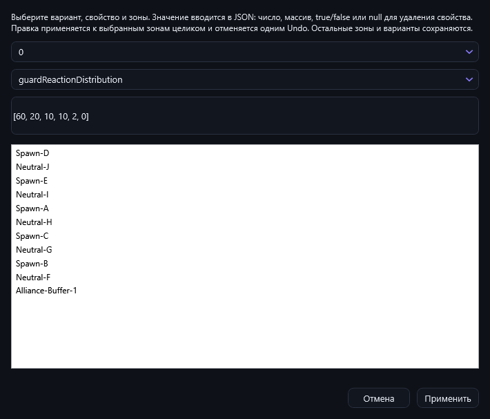
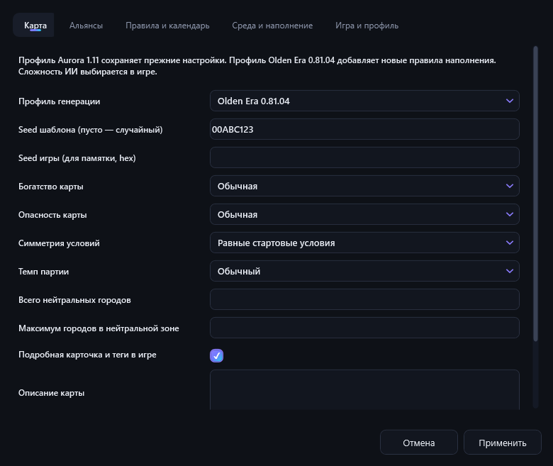
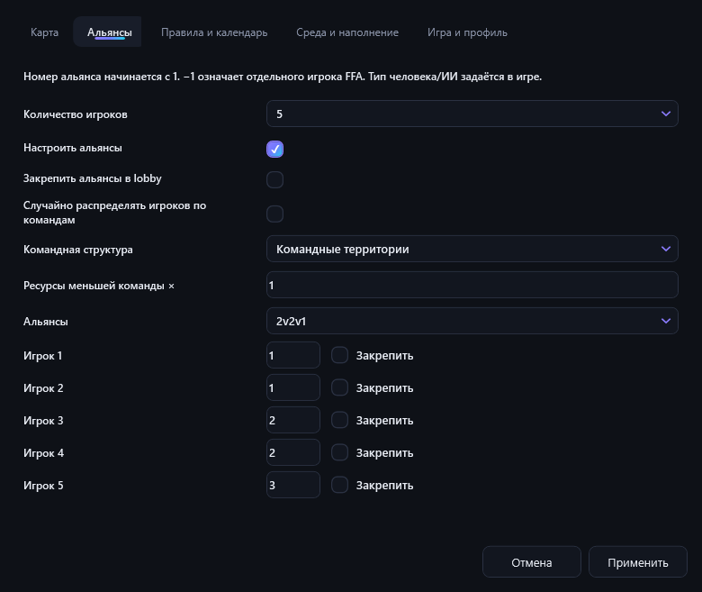
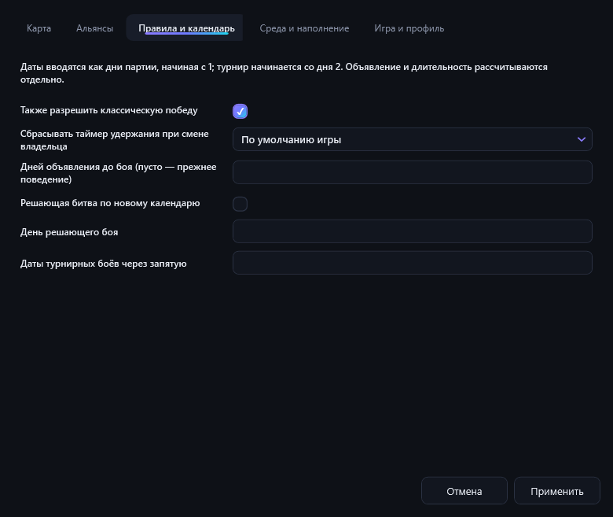
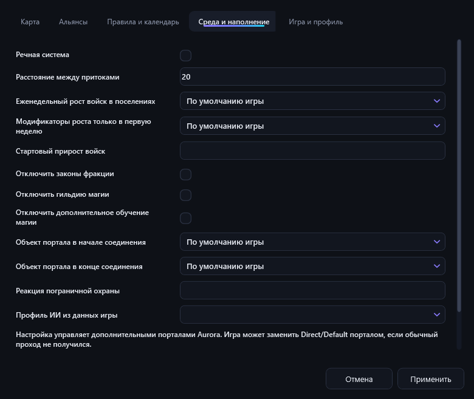
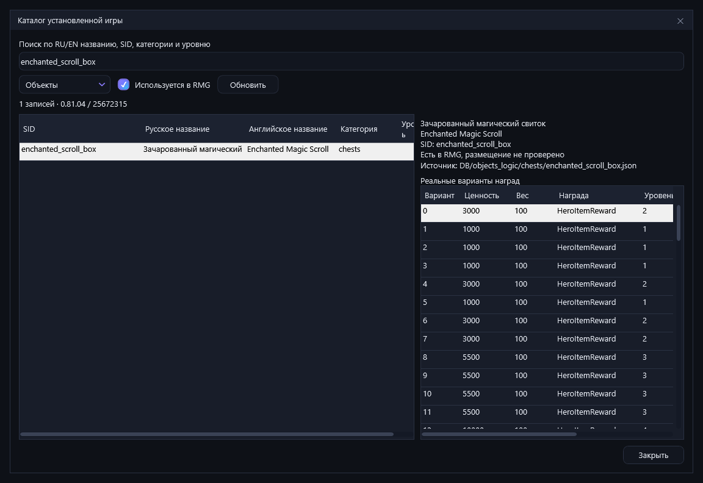
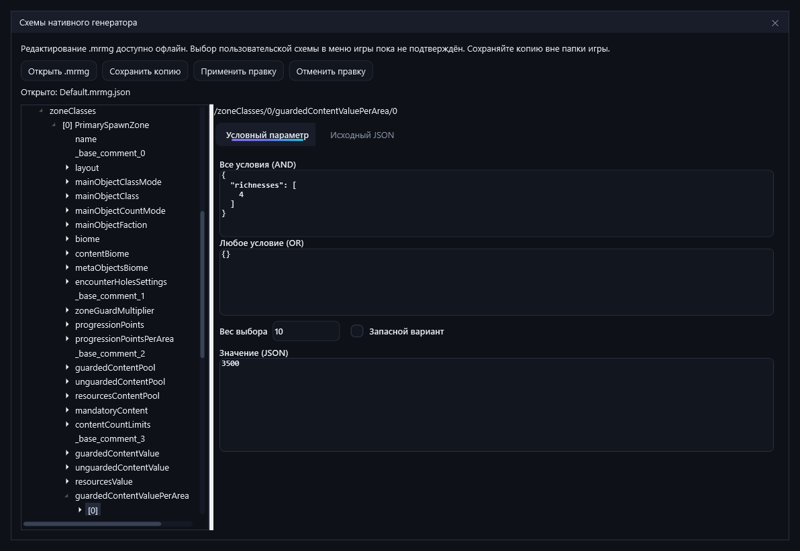
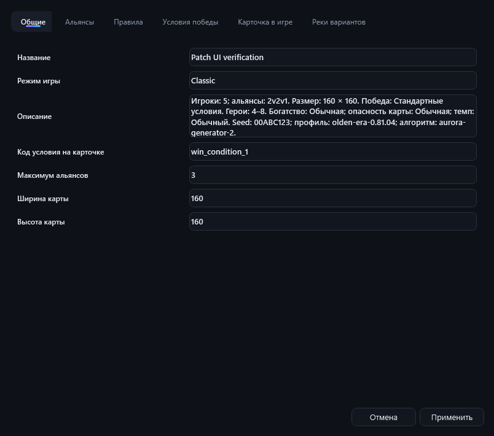
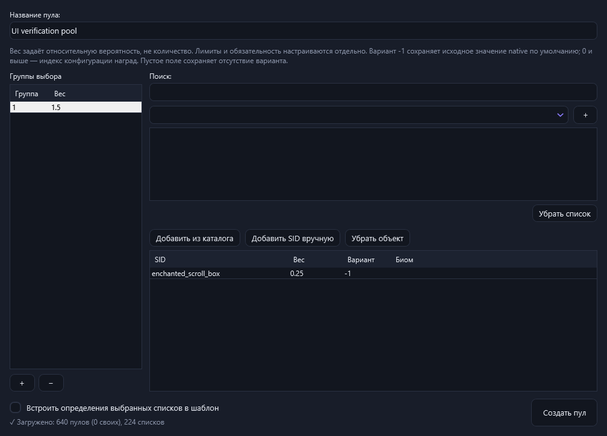

<a id="auroramrg"></a>
<div align="center">


### Генератор случайных шаблонов карт для **Heroes of Might and Magic: Olden Era**

[](https://github.com/sany86russ/AuroraRMG/releases/latest)
[](https://github.com/sany86russ/AuroraRMG/releases)
[](https://github.com/sany86russ/AuroraRMG/releases/latest)

**Настраивай карту в удобном интерфейсе вместо ручного редактирования JSON — и жми «Создать шаблон».**

[📥 Скачать](#-установка) · [🚀 Быстрый старт](#-быстрый-старт) · [🧭 Обзор интерфейса](#-обзор-интерфейса) · [⚙️ Все настройки](#️-все-настройки-подробно) · [🎲 Пресеты](#-готовые-пресеты-53-и-43-legacy) · [❓ FAQ](#-частые-вопросы-faq)

🌍 **Русский** · [English](README.en.md)

</div>

## Новое в v1.12.0

Адаптация к **Olden Era 0.81.04**: настоящие альянсы и кооперативные структуры, **53 актуальных пресета** (43 обновлённых + 10 командных), отдельные 43 Legacy-пресета, богатство и опасность карты, календарь боёв, реки и рост войск. Новый каталог читает SID, имена и варианты наград из вашей установки игры; редактор поддерживает свойства шаблона, массовую правку зон и дробные веса пулов.

Настройки `.oetgs` сохраняют полный снимок генерации. Добавлены ZIP-пакеты для обмена, последовательная генерация наборов, локальная диагностика и отдельный редактор нативных схем `.mrmg.json`. Все команды доступны через **«Карта и инструменты»** в обоих режимах.

[Список изменений v1.12.0 RU/EN](docs/release-notes-v1.12.0.md) · [Скачать v1.12.0](https://github.com/sany86russ/AuroraRMG/releases/tag/v1.12.0) · [Проверки реализации и игровая приёмка](docs/plans/2026-10-14-implementation-status.md)

Автоматические проверки подтверждают формат и поведение редактора. Конкретную геометрию, размещение объектов, союзную победу и работу календаря проверяйте в игре на нескольких игровых seeds.

## Ранее: v1.11.0

Охрана границ и порталов до **800%**, настройка фракций нейтральных городов без ручного JSON, исправленные зеркальные связи и отмена действий. Обновлены компоновка окон, переводы RU/EN, сохранение файлов и автообновление.

[Полный список изменений RU/EN](docs/release-notes-v1.11.0.md) · [Скачать v1.11.0](https://github.com/sany86russ/AuroraRMG/releases/tag/v1.11.0)

---

> [!NOTE]
> **Основано на проекте [Olden-Era---Template-Generator](https://github.com/KhanDevelopsGames/Olden-Era---Template-Generator/) от [KhanDevelopsGames](https://github.com/KhanDevelopsGames).**
> Идея и базовый подход к генерации `.rmg.json` взяты у него — спасибо автору оригинала! AuroraRMG — это переработанная версия с новым оформлением (тема **Aurora**), полной двуязычной локализацией (**RU/EN**), визуальным редактором зон, расширенным набором настроек и собственным автообновлением. Подробнее — в разделе [Благодарности](#-благодарности-и-происхождение).

---

## 📑 Содержание

- [Что это такое](#-что-это-такое)
- [Установка](#-установка)
- [Проверка подлинности сборки](#-проверка-подлинности-сборки)
- [Автообновление](#-автообновление)
- [Быстрый старт](#-быстрый-старт)
- [Режимы работы: Простой и Расширенный](#-режимы-работы-простой-и-расширенный)
- [Обзор интерфейса](#-обзор-интерфейса)
- [Все настройки (подробно)](#️-все-настройки-подробно)
  - [Вкладка «Правила»](#вкладка--правила)
  - [Вкладка «Карта и зоны»](#вкладка--карта-и-зоны)
  - [Вкладка «Бонусы и баны»](#вкладка--бонусы-и-баны)
  - [Вкладка «Доп. контент»](#вкладка--доп-контент-эксп)
- [Карта и инструменты: возможности v1.12.0](#-карта-и-инструменты-возможности-v1120)
  - [Профиль, seeds и параметры карты](#профиль-seeds-и-параметры-карты)
  - [Альянсы и кооператив](#альянсы-и-кооператив)
  - [Каталог и пулы контента](#каталог-и-пулы-контента)
  - [Нативные схемы и импорт конфигурации](#нативные-схемы-и-импорт-конфигурации)
  - [ZIP-пакеты, наборы и диагностика](#zip-пакеты-наборы-и-диагностика)
- [Панель превью и генерация](#-панель-превью-и-генерация)
- [Анализ карты: баланс и состав](#-анализ-карты-баланс-и-состав)
- [Визуальный редактор зон](#-визуальный-редактор-зон)
- [Язык интерфейса (RU/EN)](#-язык-интерфейса-ruen)
- [Готовые пресеты (53 и 43 Legacy)](#-готовые-пресеты-53-и-43-legacy)
- [Условия победы и спец-режимы](#-условия-победы-и-спец-режимы)
- [Сохранение и загрузка настроек](#-сохранение-и-загрузка-настроек)
- [Куда сохранять шаблоны](#-куда-сохранять-шаблоны)
- [Запуск без помех игре](#-запуск-без-помех-игре)
- [Советы и нюансы генерации](#-советы-и-нюансы-генерации)
- [Частые вопросы (FAQ)](#-частые-вопросы-faq)
- [Поддержать создателя](#-поддержать-создателя)
- [Благодарности и происхождение](#-благодарности-и-происхождение)
- [Дисклеймер и лицензия](#disclaimer-license)

---

## 🗺 Что это такое

**AuroraRMG** — настольное приложение для Windows, которое создаёт файлы шаблонов случайных карт (`.rmg.json`) для игры **Heroes of Might and Magic: Olden Era**.

Шаблон карты — это набор правил, по которым игра при старте новой партии сама строит случайную карту: сколько игроков, как связаны зоны, сколько ресурсов и замков, какой ландшафт, насколько сильны нейтральные монстры и так далее. Раньше такие файлы приходилось писать руками в JSON. AuroraRMG даёт визуальный редактор: ты крутишь ползунки и галочки → нажимаешь **«Создать шаблон»** → получаешь готовый `.rmg.json`, который игра видит в списке шаблонов.

**Ключевые возможности:**

| | |
|---|---|
| ⚡ **Два режима работы** | **Простой** — карта в пару кликов (выбрал несколько опций → готово); **Расширенный** — полный ручной контроль. Переключатель в шапке. См. [Режимы работы](#-режимы-работы-простой-и-расширенный). |
| 🎲 **53 актуальных пресета + 43 Legacy** | 43 обновлённых 1v1 / FFA / PvE + 10 командных; прежние конфигурации Aurora 1.11 доступны отдельно |
| 🤝 **Альянсы и кооператив** | 2v2, 3v3, 4v4, несколько команд и неравные составы; ручное назначение и закрепление слотов |
| 🗺 **Визуальный редактор зон** | интерактивный холст: зоны, связи, инспектор, экспорт PNG — правь граф карты руками |
| 🌍 **Два языка (RU/EN)** | мгновенное переключение языка в шапке, без перезапуска; автоопределение по локали |
| 🚫 **Баны предметов, заклинаний и героев** | полный список героев с настоящими именами (опц. из ассетов игры) |
| 🧩 **Параметры карты** | топология, экономика, охрана, календарь, рост войск, ландшафт, реки и условия победы; **256×256 штатно**, до **512×512 экспериментально** |
| 📚 **Каталог из вашей игры** | поиск RU/EN/SID, реальные варианты наград и зависимости пулов; встроенные настройки работают и без игры |
| 📦 **Обмен и повторение** | полные `.oetgs`, ZIP с памяткой RU/EN, наборы по seeds и пресетам, локальный диагностический архив |
| ⚖ **Анализ карты** | сразу после генерации — **оценка баланса 0–100** + разбор «что внутри» (зоны, связи, сокровища) |
| 🖼 **Превью карты** | визуальная схема расположения и связей зон ещё до сохранения |
| 🌑 **Тема Aurora** | тёмный неоновый интерфейс (фиолетовый → циан) с фирменными меню |
| 🔄 **Автообновление** | приложение само находит и ставит новую версию с GitHub |
| 📦 **Один файл** | автономный `.exe`, установка не требуется |
| 🧭 **Поиск установки игры** | библиотеки Steam и манифест игры; при необходимости — явно заданная папка установки |

---

## 📥 Установка

1. Открой страницу **[последнего релиза](https://github.com/sany86russ/AuroraRMG/releases/latest)**.
2. Скачай файл **`AuroraRMG.exe`** из раздела *Assets*.
3. Запусти его. Готово — установка не нужна, это автономный единый `.exe`.

> [!IMPORTANT]
> **Требования:** Windows 10 или 11 (64-bit). Дополнительный .NET-рантайм ставить **не нужно** — он уже встроен в `.exe` (сборка self-contained).

> [!TIP]
> При первом запуске Windows SmartScreen может предупредить о «неизвестном издателе» (файл не подписан сертификатом). Нажми **«Подробнее» → «Выполнить в любом случае»**. Исходный размер файла — около 65 МБ. О том, как убедиться, что файл подлинный — ниже.

---

## 🔐 Проверка подлинности сборки

Файл `AuroraRMG.exe` **не подписан** платным сертификатом издателя (поэтому SmartScreen и ругается на «неизвестного издателя»). Но это **не значит, что его нельзя проверить** — наоборот.

Каждый релиз собирается **не на чьём-то домашнем компьютере, а прямо на серверах GitHub** из этого открытого исходного кода — workflow [`.github/workflows/release.yml`](.github/workflows/release.yml). При сборке GitHub выпускает криптографически подписанный **аттестат происхождения (build provenance attestation)**, который намертво связывает конкретный `.exe` с конкретным коммитом этого репозитория и конкретным запуском сборки.

Это прямо закрывает главный страх: *«вдруг кто-то взял проект, подсунул в `.exe` зловред и перевыложил»*. Подменённый файл **не пройдёт проверку** — у него не будет валидного аттестата от этого репозитория.

**Как проверить (нужен бесплатный [GitHub CLI](https://cli.github.com/)):**

```bash
gh attestation verify AuroraRMG.exe --repo sany86russ/AuroraRMG
```

Если файл настоящий, увидишь что-то вроде `✓ Verification succeeded!` — это значит, что именно **этот** бинарник был собран GitHub'ом из исходников **этого** репозитория и с тех пор не изменялся. Если проверка не прошла — файл скачан не отсюда либо изменён, **запускать его не стоит**.

> [!TIP]
> Подробнее о технологии — в документации GitHub: [Artifact Attestations](https://docs.github.com/en/actions/concepts/security/artifact-attestations).

---

## 🔄 Автообновление

AuroraRMG умеет обновляться сам, без ручного скачивания.

- **При каждом запуске** приложение тихо проверяет последний релиз в этом репозитории.
- Если доступна версия новее установленной — вверху окна появляется **баннер**:

  > ✨ Доступна новая версия AuroraRMG vX.Y · **[Обновить]** · [Что нового] · [Позже]

- **Обновить** — приложение скачает новый `.exe`, покажет окно прогресса, заменит себя и перезапустится.
- **Что нового** — откроет страницу релиза с описанием изменений.
- **Позже** — спрячет баннер до следующего запуска.

Текущая версия всегда видна **в шапке окна**, в бейдже рядом с названием `AuroraRMG`.

Перед установкой проверяются размер файла, формат Windows EXE и SHA-256, если он указан в релизе. Незавершённая загрузка удаляется. При замене сохраняется предыдущий файл (`.previous`); ошибка замены не повреждает рабочую версию.

> [!NOTE]
> Проверка обновлений **пропускается**, если приложение запущено с флагом `--minimized` (см. [Запуск без помех игре](#-запуск-без-помех-игре)). Если интернета нет или GitHub недоступен — приложение просто молча работает дальше.

---

## 🚀 Быстрый старт

**Способ 1 — Простой режим (самый лёгкий, рекомендуется новичкам):**

1. Запусти AuroraRMG — по умолчанию открывается **Простой режим** (переключатель **Простой / Расширенный** — в шапке, рядом с языком).
2. Выбери несколько опций: число игроков, тип игры, размер, длительность, условие победы.
3. В **«Карта и инструменты → Команды и параметры карты»** выбери профиль **Olden Era 0.81.04**; для игры с друзьями настрой вкладку **«Альянсы»**. Здесь же можно указать путь к игре.
4. Нажми **«⚔ Создать карту»** — справа появится превью, сводка и предупреждения. Исправь ошибки перед сохранением.
5. Нажми **«💾 Сохранить в папку игры»** — введи название шаблона.
6. Запусти Olden Era → создай новую игру → выбери шаблон; назначь людей/ИИ, фракции, сложность ИИ и игровой seed в lobby/hotseat.

Подробнее — в разделе [Режимы работы](#-режимы-работы-простой-и-расширенный).

**Способ 2 — через пресет (Расширенный режим):**

1. Переключись в **Расширенный** режим.
2. На вкладке **«Правила карты»** в блоке **ШАБЛОН** открой **«Пресет»** и выбери группу **Olden Era 0.81.04**, командный пресет или отдельную группу **Aurora 1.11 / Legacy**.
3. Нажми **«⚔ Создать шаблон»** в правой панели, затем кнопку сохранения.
4. Запусти Olden Era → создай новую игру → выбери шаблон.

**Способ 3 — вручную (Расширенный режим):**

1. Задай **название**, **число игроков** и **размер карты**.
2. Пройдись по вкладкам и настрой топологию, зоны, экономику, окружение.
3. Нажми **«⚔ Создать шаблон»** — справа появится **превью** схемы зон.
4. Проверь предупреждения валидации (если есть) и сохрани файл.

---

## 🎮 Режимы работы: Простой и Расширенный

С версии **1.2.0** у AuroraRMG **два режима работы**. Переключатель **Простой / Расширенный** находится **в верхней панели окна, рядом с переключателем языка (RU/EN)**. Выбранный режим запоминается между запусками; при первом запуске открывается **Простой**.

### ⚡ Простой режим — «карта в пару кликов»


Для тех, кто **не хочет разбираться в шаблонах**. Вы задаёте несколько понятных опций, генератор подбирает остальные и создаёт шаблон для последующей генерации карты в игре:

| Опция | Что задаёт |
|---|---|
| **Игроков** | Сколько игроков (стартовых замков) на карте. |
| **Тип игры** | **Дуэль (1×1)**, **Каждый сам за себя**, **Против монстров (PvE)**, **Дорожки (коридоры)**, **Командная игра** с настоящими альянсами или **Один игрок (RPG/PvE, эксперим.)**. Состав команд уточняется через «Карта и инструменты»; людей и ИИ выбирайте в игре. |
| **Размер карты** | Маленькая / Средняя / Большая / Огромная. В профиле **0.81.04** Огромная использует **256×256**; в **Legacy** сохранён прежний экспериментальный диапазон **256–400**. |
| **Длительность** | Короткая / Средняя / Длинная — влияет на размер, число зон и силу охраны. |
| **Уровень хаоса** | Спокойный / Обычный / Дикий — насколько «дикой» и непредсказуемой будет карта. |
| **Условие победы** | Классика, удержание города/столицы, решающая битва, турнир, падение стража (см. [условия и ограничения](#-условия-победы-и-спец-режимы)). |
| **Охрана границ** | Сила монстров-стражей на проходах между зонами: **Слабая / Обычная / Сильная / Крепость / Неприступная / 800%**. Новый пункт **800%** задаёт ровно 800% при любом уровне хаоса; прежние уровни сохранены (в расширенном режиме — ползунок «Охрана границ/порталов»). |
| **Фракция нейтр. замков** | Какой фракции будут **захватываемые** замки в нейтральных зонах: **Случайная** или конкретная (Люди/Нежить/Подземелье/Природа/Демоны/Размороженные). Полноценный город выбранной фракции — ничей, пока его не захватишь. Удобно для «дорожек» с друзьями, где по пути надо взять город нужной фракции. |
| **Дополнительно** | Вода, порталы, усиленные нейтралы. |
| **Сид** 🎲 📋 | Воспроизводит **шаблон Aurora** вместе с полным `.oetgs`, тем же профилем и версией алгоритма. Игровой seed задаётся отдельно в игре. 🎲 — новый случайный, 📋 — скопировать. |

Дальше: **«⚔ Создать карту»** → справа появятся **превью** и краткая **сводка** (включая оценку длительности партии, **оценку баланса** и разбор **«что внутри карты»** — см. [Анализ карты](#-анализ-карты-баланс-и-состав)) → **«💾 Сохранить в папку игры»** (спросит название и положит карту прямо в игру) либо **«Сохранить как…»**. Внизу окна — **подсказка по каждой настройке**. Любую карту можно **«Открыть в расширенном режиме»** и доработать вручную.

### 🛠 Расширенный режим — полный контроль


Четыре основные вкладки (**Правила · Карта и зоны · Бонусы и баны · Доп. контент**) дают ручной контроль топологии, экономики, охраны, окружения и наполнения. Меню **«Карта и инструменты»** добавляет профиль, альянсы, календарь, каталог и обмен файлами. **Визуальный редактор зон** позволяет доработать сам граф. Подробно — ниже в разделах [Обзор интерфейса](#-обзор-интерфейса) и [Все настройки](#️-все-настройки-подробно).

> 💡 **Что выбрать?** Хочешь быстро получить хорошую случайную карту — **Простой**. Хочешь крутить каждую деталь — **Расширенный**. Переключаться можно в любой момент, а результат простого режима всегда можно доработать в расширенном.

---

## 🧭 Обзор интерфейса

> Ниже описан **Расширенный режим** (полный набор вкладок). Если вы в **Простом режиме** — переключитесь кнопкой **Расширенный** в шапке. Про простой режим см. [Режимы работы](#-режимы-работы-простой-и-расширенный).

Окно состоит из трёх зон:

```
┌──────────────────────────────────────────────────────────────┐
│  🧭 AuroraRMG  [v1.12]  —  имя_файла        🔄 📂 💾 💾…  _ ☐ ✕ │   ← Шапка
├───────────────┬──────────────────────────────┬───────────────┤
│  Правила      │                              │  ⚔ Создать     │
│  Карта и зоны │     Содержимое выбранной     │   шаблон       │
│  Бонусы/баны  │          вкладки             │  ┌──────────┐  │
│  Доп. контент │                              │  │ превью   │  │
│  …            │                              │  │  карты   │  │
│ ← навигация → │                              │  └──────────┘  │
│               │                              │  💾 Сохранить  │
└───────────────┴──────────────────────────────┴───────────────┘
   левый рельс         рабочая область          панель действий
```

### Шапка окна

| Элемент | Действие | Горячая клавиша |
|---|---|---|
| 🧭 **AuroraRMG** + бейдж версии | Название продукта и текущая версия | — |
| *имя файла* | Текущий файл настроек (`*` = есть несохранённые изменения) | — |
| 🔄 | Сбросить все настройки (новый шаблон) | `Ctrl + N` |
| 📂 | Открыть сохранённые настройки | `Ctrl + O` |
| 💾 | Сохранить настройки | `Ctrl + S` |
| 💾… | Сохранить настройки как… | `Ctrl + Shift + S` |
| **Простой** / **Расширенный** | Переключить режим работы (по умолчанию Простой; выбор запоминается). См. [Режимы работы](#-режимы-работы-простой-и-расширенный) | — |
| 🗺 **Редактор** | Открыть визуальный редактор зон | — |
| **RU** / **EN** | Переключить язык интерфейса (мгновенно) | — |
| **Карта и инструменты** | Профиль, альянсы, календарь, каталог, ZIP, наборы, диагностика и нативные схемы | — |
| `_` `☐` `✕` | Свернуть / развернуть / закрыть окно | — |

> «Настройки» (см. 💾) — это `.oetgs`-файл со **всеми** параметрами редактора, чтобы продолжить работу позже. Это **не** игровой шаблон. Игровой `.rmg.json` создаётся отдельно кнопкой «Создать шаблон» → «Сохранить».

### Основные вкладки Расширенного режима (4)

| Вкладка | О чём |
|---|---|
| **Правила** | Базовые параметры карты, герои, условия победы, окружение |
| **Карта и зоны** | Топология (форма карты) и детальная настройка зон |
| **Бонусы и баны** | Стартовые бонусы игрокам, запрет предметов и заклинаний |
| **Доп. контент [ЭКСП.]** | Обязательное наполнение зон (шахты, сокровища и т.д.), с учётом возможностей размещения игры |

### Как это выглядит

<details open>
<summary><b>Вкладка «Правила»</b> — базовые параметры, герои, условия победы, окружение</summary>


</details>

<details>
<summary><b>Вкладка «Карта и зоны»</b> — топология карты и настройка зон</summary>


</details>

<details>
<summary><b>Вкладка «Бонусы и баны»</b> — стартовые бонусы и запрет предметов/заклинаний</summary>


</details>

<details>
<summary><b>Вкладка «Доп. контент [ЭКСП.]»</b> — обязательное наполнение зон</summary>


</details>

> 💡 Скриншоты сделаны на актуальной версии в теме **Aurora**. Интерфейс доступен на русском и английском — переключение в шапке (RU/EN).

---

## ⚙️ Все настройки (подробно)

> Значения в скобках — **диапазон** и **значение по умолчанию**. Метка `[ЭКСП.]` означает экспериментальную функцию, которая может давать нестабильный результат.

### Вкладка · «Правила»

#### Блок «Шаблон»

| Настройка | Описание |
|---|---|
| **Пресет** | 53 актуальные конфигурации и отдельные 43 Legacy. Выбор переносит параметры пресета; см. [пресеты](#-готовые-пресеты-53-и-43-legacy). |
| **Название шаблона** | Имя, под которым шаблон будет виден в игре. |
| **Размер карты** | Размер игрового поля. Стандартные значения от 80×80 до 256×256. |
| 🗺 **Большие карты: 272×272 … 512×512** `[ЭКСП.]` | Добавляет размеры выше штатных 256×256 в **Расширенном режиме**. Их генерация и производительность требуют отдельной игровой проверки. В актуальном Простом режиме «Огромная» — 256×256; только Legacy сохраняет прежний диапазон 256–400. |
| **Игроки** | Число стартовых игроков *(1 – 8, по умолчанию 2)*. Один игрок — экспериментальный сценарий. |

#### Блок «Герои»

| Настройка | Описание |
|---|---|
| **Начальный лимит героев** | Вместимость найма при принадлежащих игроку стартовых городах *(1 – 12, по умолч. 4)*; не количество автоматически созданных героев. |
| **Макс. лимит героев** | Верхняя граница вместимости найма *(1 – 12, по умолч. 8)*. |
| **Прирост лимита за замок** | Добавка к вместимости за принадлежащий игроку город *(0 – 10, по умолч. 1)*; учитывается и для стартовых городов. |
| **Режим одного героя** | Особый режим: у игрока всего один герой. |

В профиле 0.81.04 Aurora учитывает число принадлежащих игроку стартовых городов и переводит выбранный лимит в базовое правило игры. Если их суммарная добавка уже больше выбранного начального лимита, увеличь лимит или уменьши прирост/число стартовых городов. В «Свойствах шаблона» редактируется именно нативный базовый минимум. Фактическое число созданных стартовых героев проверяйте в игре.

#### Блок «Правила игры»

| Настройка | Описание |
|---|---|
| **Опыт законов фракций** | Множитель опыта по законам фракций *(25% – 200%, шаг 25, по умолч. 100%)*. |
| **Опыт астрологии** | Множитель опыта астрологии *(25% – 200%, шаг 25, по умолч. 100%)*. |
| **Основное условие победы** | Главное условие победы (см. [таблицу](#-условия-победы-и-спец-режимы)). |
| **Поражение при потере стартового города** | Включает правило потери ключевого стартового города. Параметр **«День потери города»** *(1 – 30)* сохраняется отдельно; проверьте отсчёт и поражение в игре. |
| **Поражение при потере стартового героя** | Игрок выбывает, потеряв стартового героя. |
| **Победа за удержание нейтр. города** | Режим *City Hold*: нужно захватить и удержать назначенный город. Ползунок **«Дней удержания»** *(1 – 30, по умолч. 6)*. Подробности — в [спец-режимах](#-условия-победы-и-спец-режимы). |
| **Правила турнира** | Турнир 1v1: очки для победы, первый бой, интервал и сохранение армии. Явный календарь задаётся в «Карта и инструменты → Команды и параметры карты → Правила и календарь». См. [спец-режимы](#-условия-победы-и-спец-режимы). |

#### Блок «Окружение и встречи»

| Настройка | Описание |
|---|---|
| **Тип ландшафта** | Биом карты: **По фракции** (ландшафт зоны зависит от фракции её города — поведение движка по умолчанию), **Случайный микс** (каждая зона выбирает биом сама), либо фикс. биом: **Трава, Снег, Лава, Песок, Грязь, Мёртвые земли, Осень**. |
| **Агрессия монстров** | Как охрана реагирует на игрока: **Пассивная** (чаще пропускают/бегут), **Обычная** (по умолчанию), **Агрессивная** (почти всегда дерутся). |
| **Количество воды** | Водные границы между зонами: **Нет / Немного / Средне / Много**. Стиль воды подстраивается под выбранный ландшафт. |
| **Шанс перехода нейтр.** | Дипломатический модификатор для всех зон: насколько охотно нейтралы бегут или присоединяются *(-1.00 … +1.00, по умолч. -0.50)*. Выше — охотнее переходят к игроку. |
| **Неровность ландшафта** | Плотность препятствий (камни, лес) в каждой зоне *(0% – 200%, по умолч. 100%)*. |
| **Количество озёр** | Покрытие зон озёрами *(0% – 200%, по умолч. 100%)*. |
| **Разрешить обход охраны (лазейки)** | Включает «дыры» в охране — некоторых стражей можно обойти, не вступая в бой. |

---

### Вкладка · «Карта и зоны»

#### Блок «Топология» — форма карты

| Топология | Как расставлены и связаны зоны |
|---|---|
| **Сбалансированная** | Зоны по концентрическим кольцам уровня качества: игроки снаружи, нейтралы внутри; связи — с соседями на смежных кольцах. *(по умолчанию)* |
| **Случайная** | Зоны в случайных позициях, каждая соединена со всеми граничащими (на основе триангуляции Делоне). |
| **Кольцо** | Все зоны по кругу, каждая связана с двумя соседями. |
| **Хаб** | Все зоны соединяются с общим центральным хабом; игроки никогда не граничат напрямую. |
| **Цепь** | Зоны выстроены в линию от одного конца к другому, без замыкания. |
| **Дорожки** | Параллельные непересекающиеся коридоры: каждый игрок идёт по своему пути зон **бронза → серебро → золото**, и все коридоры сходятся только в одной центральной спорной «арене» в конце. Игроки встречаются лишь там; охрана на проходах нарастает к центру. Нейтральные замки раздаются по коридорам **поровну** — ни у кого не будет «лишнего» замка на пути. В Простом режиме этому соответствует тип игры **«Дорожки (коридоры)»**. |


Дополнительно (зависит от топологии):

| Настройка | Когда видна | Описание |
|---|---|---|
| **Размер зоны хаба** | топология «Хаб» | Множитель размера центральной зоны *(0.25× – 3×, по умолч. 1×)*. |
| **Замки в хабе** | топология «Хаб» | Сколько замков в центральном хабе *(0 – 4, по умолч. 0)*. |
| **Соединять только через нейтр. зоны** | при изоляции | Игра старается связывать зоны игроков только через нейтральные. Если рядом нет нейтральной зоны — произойдёт прямое соединение. |

#### Блок «Настройка зон»

Базовые ползунки (всегда доступны):

| Настройка | Описание |
|---|---|
| **Замки в зонах игроков** | Сколько замков в стартовой зоне каждого игрока *(1 – 4, по умолч. 1)*. |
| ↳ **Одна фракция для всех замков в зоне игрока** | Все замки в зоне игрока — одной фракции (видно при >1 замке). |
| ↳ **Игрок начинает со всеми замками в своей зоне** | Игрок сразу владеет всеми замками своей зоны. |
| **Замки в нейтр. зонах** | Сколько замков в нейтральной зоне (если зона «с замком») *(1 – 4, по умолч. 1)*. |
| **Частота ресурсов** | Плотность ресурсов и рудников *(20% – 400%, по умолч. 100%)*. |
| **Частота построек** | Плотность построек/объектов *(20% – 200%, по умолч. 100%)*. |
| **Сила нейтр. войск** | Сила нейтральных армий в зонах *(25% – 300%, по умолч. 100%)*. |
| **Охрана границ/порталов** | Сила охраны на границах зон и порталах *(25% – 800%, по умолч. 100%)* — то же, что «Охрана границ» в простом режиме. **800%** увеличивает бюджет охраны в 8 раз относительно 100%, не меняя силу нейтралов внутри зон. Это усиление, а не гарантия защиты от ИИ. |
| **Фракция нейтр. замков** | Фракция **захватываемых** замков в нейтральных зонах: **Случайная** или конкретная (Люди/Нежить/Подземелье/Природа/Демоны/Размороженные). Полноценный город выбранной фракции — ничей, пока его не захватишь. То же, что в простом режиме. |
| **Генерировать дороги** | Добавляет дороги между связанными зонами *(вкл. по умолч.)*. |
| **Создавать удалённые плацдармы** | Размещает удалённые плацдармы в каждой замковой зоне *(вкл. по умолч.)*. |
| **Создавать доп. порталы** | Добавляет соединения-порталы Aurora между несмежными зонами. Лимит *(1 – 48, по умолч. 48)* относится к этим дополнениям. Отключение не гарантирует отсутствие порталов: игра может заменить неудавшийся обычный проход порталом. |

Расширенные настройки (галочка **«Расширенные настройки»** в шапке блока):

| Настройка | Описание |
|---|---|
| **Нейтральные зоны по типам** | Тонкая раскладка нейтральных зон: 6 ползунков *(каждый 0 – 30)* — **слабые / средние / сильные**, каждый в варианте **без замка** и **с замком**. Заменяет простой ползунок «Доп. нейтральные зоны». 48 зон — ориентир интерфейса по примеру Full Hire, не подтверждённый предел движка. |
| **Мин. нейтралов между игроками** | Минимум нейтральных зон между игроками *(0 – 8, по умолч. 0)*. Работает, если это позволяют топология, число зон и порталы. |
| **Размер зоны игрока** `[ЭКСП.]` | Относительный вес зоны игрока *(0.5× – 2×, по умолч. 1×)*. |
| **Размер нейтр. зоны** `[ЭКСП.]` | Относительный вес нейтральной зоны *(0.5× – 2×, по умолч. 1×)*. |
| **Разброс силы охраны** | Случайный разброс силы стражей *(0% – 50%, по умолч. 5%)*. |

> В простом режиме доступен один ползунок **«Доп. нейтральные зоны»** *(0 – 30)* — быстрый способ добавить нейтралов без разбивки по качеству.

---

### Вкладка · «Бонусы и баны»

| Раздел | Описание |
|---|---|
| **Стартовые бонусы** | Список бонусов, которые получают **все игроки одинаково** в начале партии. Кнопка **`+`** открывает выбор бонуса; **`×`** удаляет запись. |
| **Забаненные предметы** | Артефакты, которые **не появятся** на карте. **`+`** — выбрать предметы (с фильтром и категориями), **`×`** — снять бан. |
| **Забаненные заклинания** | Заклинания, исключённые из игры на этой карте. **`+`** — выбрать, **`×`** — снять бан. |
| **Забаненные герои** | Герои, которые не появятся на карте (`globalBans.heroes`). Цветные метки по фракциям. **`+`** — выбрать, **`×`** — снять бан. |

> [!TIP]
> **Герои из вашей версии игры.** По умолчанию доступен встроенный список Aurora. Галочка **«Подключить ассеты установленной игры»** подгружает имена и SID из локального `Core.zip`; количество зависит от установленной версии. Эти данные не отправляются в сеть и не входят в дистрибутив. Без подключения редактор остаётся работоспособным.

---

### Вкладка · «Доп. контент [ЭКСП.]»

> [!WARNING]
> Раздел экспериментальный. Здесь задаётся **обязательный контент** — объекты, которые должны быть размещены в каждой зоне выбранного типа, если движку хватает места. Перебор может сделать карту несбалансированной или неиграбельной.

Контент настраивается отдельно для пяти типов зон (под-вкладки):

- **Зоны игроков**
- **Слабые нейтр. зоны**
- **Средние нейтр. зоны**
- **Сильные нейтр. зоны**
- **Зоны хаба**

Внутри каждого типа объекты сгруппированы по категориям:

| Категория | Что это |
|---|---|
| ◆ **Шахты** | Рудники ресурсов (дерево, руда, золото, редкие ресурсы и т.п.) |
| ◆ **Сокровища** | Сундуки, ящики Пандоры, случайные артефакты |
| ◆ **Найм существ** | Жилища/пулы найма юнитов |
| ◆ **Хранилища ресурсов** | Банки ресурсов и склады |
| ◆ **Полезные постройки** | Вспомогательные строения |
| ◆ **Постройки развития героя** | Объекты, прокачивающие героя |

Для каждого добавленного объекта доступно:

| Параметр | Описание |
|---|---|
| **Количество** | Сколько таких объектов в зоне *(ползунок, обычно 0 – 5; для сокровищ до 8)*. |
| **Под охраной** | Объект охраняется нейтральной армией. |
| **У замка** | Объект размещается рядом с замком зоны. |
| **Дорога** | Дистанция от дороги: **Любая / Вплотную / Близко / Средне / Далеко / Очень далеко**. |

Кнопки: выпадающий список + **«Добавить»** добавляют заготовку контента; **`x`** у строки удаляет объект; **«Сбросить по умолчанию»** возвращает стандартный набор для зоны.

---

## 🧰 Карта и инструменты: возможности v1.12.0

Меню **«Карта и инструменты»** находится в шапке и доступно в Простом и Расширенном режимах. **«Команды и параметры карты»** открывает пять вкладок: **Карта · Альянсы · Правила и календарь · Среда и наполнение · Игра и профиль**. Правки вступают в силу по **«Применить»**; **«Отмена»** оставляет прежние настройки. После изменения параметров создайте шаблон заново.

### Профиль, seeds и параметры карты

1. На вкладке **«Карта»** выберите **Olden Era 0.81.04** для актуальных таблиц наполнения или **Aurora 1.11** для прежних конфигураций.
2. На вкладке **«Игра и профиль»** проверьте источник. Пустой путь включает поиск по библиотекам Steam; явный путь должен вести в корень установки игры. Показаны версия, Steam build и отпечатки данных. Неизвестная версия отмечается как неизвестная; встроенные настройки остаются доступны.
3. Задайте параметры карты, нажмите **«Применить»**, затем **«Создать шаблон»**. Подробная карточка добавляет в игру описание и теги выбранных настроек.

| Параметр | Что меняет |
|---|---|
| **Богатство карты** | Пять уровней: очень бедная, бедная, обычная, богатая, очень богатая. Меняют бюджеты ресурсов и наполнения. |
| **Опасность карты** | Шесть уровней охраны генератора: низкая, обычная, высокая, нечестная, невозможная, апокалипсис. Сложность ИИ выбирается отдельно в игре. |
| **Симметрия условий** | Асимметрия, равные стартовые условия или симметрия команд. Выравнивает настройки и структуру графа; геометрию и позиции объектов создаёт игра. |
| **Темп партии** | Прежний темп, ранний контакт, обычный или спокойное исследование. «Обычный» и «Исследование» строят граф с нейтральными промежутками вместо выбранной топологии; для сохранения своей топологии выберите «Прежний». Превью и сводка показывают фактическую структуру. Темп не задаёт поведение ИИ. |
| **Всего нейтральных городов / максимум в зоне** | Распределение точного выбранного количества по подходящим нейтральным зонам. Невозможные сочетания отклоняются. |
| **Бюджеты по пригодной площади** | Коэффициенты бюджета на каждые 10 пригодных свободных клеток. Их фактическое число известно только после генерации карты игрой. |
| **Карточка и описание** | Подробная карточка с правилами и тегами в игровом picker, плюс авторское описание. |

Seed шаблона Aurora определяет `.rmg.json`. В Простом режиме и окне параметров используйте **hex без `0x`**, например `000006C1` для десятичного 1729. Окно сначала читает hex: строка `1729` означает `0x1729` (5929); целое число со знаком читается лишь как запасной вариант, если hex не распознан. Список seeds для пакетной генерации принимает **десятичные целые**. **Seed игры (для памятки, hex)** записывается отдельно и не управляет RNG Aurora: введите его также в игре. Пустой игровой seed означает, что он не зафиксирован. Для повторения нужны полный `.oetgs`, seed шаблона, профиль генерации и та же версия алгоритма; для повторения игровой карты дополнительно важны версия игры и её seed. Импорт нативных параметров не делает RNG Aurora равным RNG игры.

### Альянсы и кооператив

1. Откройте вкладку **«Альянсы»**, включите **«Настроить альянсы»** и выберите состав: например, `2v2`, `3v3`, `4v4`, `2v2v2`, `2v6` или `custom`.
2. Для ручного состава назначьте каждому игроку номер альянса **1–8**. Одинаковые номера — союзники; **−1** — отдельный игрок FFA. Номер 0 не используется. Тип человека/ИИ здесь не фиксируется.
3. Выберите **командные территории**, **командные коридоры**, **команды вокруг арены** либо сохранение выбранной топологии. Симметрия команд требует включённых назначений альянсов.
4. При необходимости закрепите все альянсы в lobby или отдельные ручные слоты. Случайное распределение использует seed шаблона и сохраняет размеры команд; ручные слоты имеют приоритет.
5. Создайте и сохраните шаблон. В lobby/hotseat назначьте друзей и ИИ, фракции и сложность; проверьте отображаемые альянсы перед началом партии.

Союзные проходы, общий тыл и фронт относятся к графу зон. Дополнительные порталы в симметричном командном профиле распределяются одинаково; слишком маленький лимит требует исправления. Множитель ресурсов меньшей команды применяется явно: неравные составы сами по себе не обещают равную сложность.

**«Подробный отчёт о структуре и балансе»** показывает игроков и альянсы, принадлежащие стартовые города, ресурсы, коэффициенты площади, минимальное число переходов к сопернику и бюджеты охраны до городов/охраняемого наполнения. Разные минимумы могут относиться к разным путям. Это оценка структуры, не расстояние в игровых ходах и не подтверждение одинаковой геометрии.

### Правила и календарь

Выберите основное условие победы в обычных правилах, затем откройте **«Правила и календарь»**. Здесь отдельно управляются классическая победа и сброс таймера удержания города. Ключевой объект и принадлежность стартового города — разные свойства.

Для турнира вводите **даты боёв через запятую**, например `7, 14, 21`: от **2 до 256**, строго по возрастанию, до **19 дат**. Срок объявления задаётся отдельно; программа переводит даты в объявления и длительности. При пустом списке используются обычные поля первого боя и интервала. Сохранение армии включается отдельным флажком в основных правилах турнира.

**«Решающая битва по новому календарю»** и её день отделены от прежних параметров арены. Турнир и решающая битва текущего профиля требуют **двух отдельных противников**. Для нескольких команд выберите другой поддержанный режим. Реальный момент объявления, регистрация и завершение боя проверяются в игре.

### Среда, рост войск и ИИ

На вкладке **«Среда и наполнение»** включаются реки и расстояние между притоками, еженедельный прирост поселений, стартовый прирост и применение модификаторов только в первую неделю. Пустое/третье состояние необязательной настройки сохраняет поведение игры. Законы фракций, гильдия магии и дополнительное обучение магии отключаются независимо.

Реакция пограничной охраны настраивается отдельно от силы охраны. Флаги портала относятся к объектам на начале и конце соединения; по ним нельзя обещать направление перехода или полное отсутствие порталов. Выбор профиля ИИ использует установленные игровые SID без кампаний и сценарных наборов. Он не обещает «пассивный ИИ» или запрет атак; если источник не установлен, проверенные варианты недоступны.

### Каталог и пулы контента

Откройте **«Карта и инструменты → Каталог установленной игры»**. Ищите по русскому/английскому имени, **точному SID**, категории и имеющемуся уровню; выберите объекты, заклинания или артефакты. **«Обновить»** перечитывает источник после патча. Отметки различают **«есть в данных»**, **«есть в RMG»** и неподтверждённое размещение. Наличие SID в Core не означает, что объект можно разместить на любой карте.

Нижняя таблица показывает существующие **индексы вариантов награды**, ценность, вес и параметры. Для свитков используются реальные варианты объекта и связанные заклинания; уровни и индексы не выдумываются. Неизвестный вариант известного объекта блокирует строгий экспорт. Отсутствующий `variant` и нативный default `−1` сохраняются отдельно от конкретного индекса.

В визуальном редакторе откройте **«Пулы» → «Содержимое пулов» / «Создание пулов»**. Просмотрщик различает вес группы и объекта, вариант, биом, включённые списки и отсутствующие ссылки. Определение внутри шаблона имеет приоритет перед локальной библиотекой и установленной игрой. Конструктор допускает прямые объекты и зависимости от списков; нужные определения встраиваются в игровой файл.

Вес — **относительный выбор**, не количество объектов. Дроби допускаются через точку или запятую; нечисловые, отрицательные, слишком большие и исчезающие при преобразовании в native float веса отклоняются. Явный 0 отключает выбор; отсутствующий вес объекта использует нативный default 1 и сохраняет отсутствие поля при неизменённой правке. Обязательное количество и лимиты настраиваются отдельно. Удалённые SID показываются с предупреждением без автоматической подмены похожим объектом.

### Свойства шаблона и массовая правка

В редакторе **«Свойства шаблона»** меняют общие параметры, альянсы, игровые правила, карточку и реки каждого варианта карты. Код условия на карточке не заменяет реальные флаги победы. В инспекторе объекта доступны ключевой объект, цель удержания города и рост найма; у связи — параметры порталов и реакции охраны.

**Массовая правка зон**: выберите вариант карты, свойство и целевые зоны. Введите значение в JSON — число, массив, `true`/`false` или `null` для удаления свойства — и примените. Изменения проходят проверку, применяются целиком и отменяются одним Undo; остальные зоны и варианты сохраняются. Существующие неизвестные поля остаются в шаблоне. Переименование, удаление и зеркало обновляют подтверждённые ссылки; непонятные конструкции отмечаются предупреждением. Повторяющиеся JSON-свойства, включая вложенные и неизвестные, отклоняются до импорта: программа не выбирает одно из неоднозначных значений.

<details>
<summary><b>Массовая правка зон</b> — свойства, выбранные зоны и отмена одним действием</summary>



</details>

### Нативные схемы и импорт конфигурации

**«Карта и инструменты → Профили процедурной генерации»** открывает отдельный редактор `.mrmg.json`. При найденной игре можно изучить её схему; **«Открыть .mrmg»** выбирает другой файл. В дереве выберите условный параметр, измените **AND/OR-условия**, вес, запасной вариант и JSON-значение, затем нажмите **«Применить правку»**. Перед переходом к другому узлу примените или отмените текущую правку. Вкладка **«Исходный JSON»** сохраняет неизвестные поля.

**«Сохранить копию»** пишет отдельный файл **вне папки игры** после проверки. Выбор пользовательской схемы в игровом picker пока не подтверждён; создание файла не регистрирует новый пункт меню игры.

**«Импорт настроек игры»** принимает JSON или compact-код и переносит подтверждённые параметры в Расширенный режим. Нативные даты переводятся из счёта с нуля в человеческие дни. Compact-код не содержит лимитов героев — существующие значения не подменяются. Исходная схема, неизвестные и непереносимые параметры остаются в снимке с предупреждениями; это перенос настроек, без воспроизведения нативной геометрии или RNG. Подробности — в [исследовании формата](docs/plans/engine-capabilities-08104.md).

### ZIP-пакеты, наборы и диагностика

| Команда в меню | Порядок работы и результат |
|---|---|
| **Сохранить пакет шаблона** | Сначала создайте актуальный шаблон. Выберите, включать ли точный `.oetgs` и PNG-превью, затем сохраните ZIP вне игры. Внутри — `.rmg.json`, памятки RU/EN и manifest с хешами, профилем и seeds. Неподходящие варианты/ссылки блокируют сохранение. |
| **Создать набор по seeds** | Укажите уникальные целые seeds, выберите отдельную существующую папку. Для каждого seed создаётся и проверяется отдельный `.rmg.json`. |
| **Набор из 43 новых пресетов / Набор командных пресетов** | Генерирует соответствующую группу для выбранных seeds. Общий предел — **128 результатов**: например, 43 пресета × 2 seeds = 86. |
| **Пакет диагностики** | Выберите ZIP и, при желании, конкретные логи. Архив создаётся локально; автоматической отправки нет. |

Пакетная генерация идёт **последовательно**, показывает ошибки каждого случая и поддерживает отмену. Успешные файлы остаются; имеющиеся файлы не заменяются. Seed игры в пакетах — памятка, без вмешательства в игровую генерацию. В `map_templates` копируйте **только `.rmg.json`**, не весь ZIP.

В пакет попадают только выбранные материалы. Если точные настройки содержат известные поля учётных данных, включение `.oetgs` блокируется: можно сохранить пакет без настроек или удалить такие данные в собственной копии. Исходные личные настройки не редактируются. Авторское описание сохраняется как введено — проверьте его перед обменом.

Диагностика включает сокращённые настройки, результат валидации и ограниченные фрагменты только выбранных логов. Известные пути и шаблоны секретов маскируются; сокращённые и непрочитанные логи отмечаются в результате. Полные импортированные нативные схемы заменяются **размером и SHA-256 с причиной пропуска**, исходный `.oetgs` остаётся целым. Игровые ассеты и дампы не добавляются. Перед ручной передачей архива просмотрите его содержимое; неизвестный текст не может считаться автоматически обезличенным.

### Новые окна

| Параметры карты | Альянсы |
|:---:|:---:|
|  |  |
| **Правила и календарь** | **Среда и наполнение** |
|  |  |
| **Каталог игры** | **Нативная схема** |
|  |  |
| **Свойства шаблона** | **Конструктор пула** |
|  |  |

---

## 🖼 Панель превью и генерация

Правая колонка окна:

| Элемент | Описание |
|---|---|
| **⚔ Создать шаблон** | Генерирует карту по текущим настройкам и строит её **превью**. |
| **Список валидации** | Если есть проблемы (например, турнир выбран при ≠2 игроках, или для City Hold не нашлось города) — здесь появятся предупреждения/ошибки. Ошибки блокируют сохранение. |
| **Превью карты** | Схема зон: расположение, связи, замки, City-Hold-город отмечен **золотой иконкой дома**. |
| **Анализ карты** | Под превью — **оценка баланса 0–100** с замечаниями и строка **«что внутри»** (зоны, связи, сокровища, ресурсы). См. [Анализ карты](#-анализ-карты-баланс-и-состав). |
| **Предупреждение об устаревании** | Если после генерации изменить настройки — превью помечается устаревшим, и его нужно перегенерировать. |
| **Сохранять превью рядом с шаблоном** | Галочка: сохранить картинку-превью в папке шаблона (игра может показывать её при выборе карты). |
| **💾 Сохранить** | Сохраняет готовый `.rmg.json` (по умолчанию открывает папку шаблонов игры). |

---

## ⚖ Анализ карты: баланс и состав

После генерации (в **обоих** режимах) AuroraRMG сразу показывает краткий анализ получившейся карты — в сводке Простого режима и в правой панели Расширенного. Всё считается **локально**, по графу карты; ничего не отправляется в сеть.

### ⚖ Равенство стартов (0–100)

Проходы и порталы учитываются отдельно от соседства **Proximity**, которое не позволяет герою перейти в другую зону. Если старты игроков разобщены, оценка равна **0** и показано предупреждение; намеренная изоляция в турнире — исключение.

Насколько равны стартовые условия игроков. Для каждого игрока учитываются: **стартовое богатство** зоны, **простор для развития** рядом (ценность соседних зон), **дистанция до ближайшего соперника** и **доступ к нейтральным замкам**. Чем меньше разброс между игроками — тем выше балл. Рядом выводятся понятные замечания, например:

- «Игрок N стартует беднее на X%»
- «Неравный доступ к нейтральным замкам»
- «Игроки N и M стартуют близко друг к другу»
- «Карта хорошо сбалансирована» — когда всё ровно

> Отчёт измеряет получившийся граф. Профили **«Равные стартовые условия»** и **«Симметрия команд»** выравнивают выбранные параметры и структуру перед генерацией; одинаковую геометрию и фактическое размещение объектов они не гарантируют.

### 🔍 Что внутри карты

Состав карты одной строкой: сколько зон и каких (**игроки / нейтральные / замки**), сколько между ними **связей** и каковы суммарные **сокровища** и **ресурсы**. Помогает оценить масштаб и богатство карты ещё до игры.

---

## 🗺 Визуальный редактор зон

Кнопка **«🗺 Редактор»** под сохранением в правой панели открывает интерактивный **холст-редактор графа зон** — можно увидеть и править структуру шаблона руками, в стиле визуальных редакторов сообщества.


- **Холст:** зоны показаны узлами (🟢 игрок · 🔵 хаб · 🟤/⚪/🟡 нейтральные по качеству), связи — рёбрами (золотая — прямая, пунктир-циан — портал, пунктир-коричневый — дорога). Есть сетка, **легенда** и подсказка управления.
- **Навигация:** колесо — зум (или кнопки **−/+**), ЛКМ по фону — перетаскивание холста, **«Сброс вида»** и **«Авто-раскладка»**.
- **Правка:** перетаскивайте зоны; **инспектор** справа сгруппирован по вкладкам (**Основные · Охрана · Пулы · Наполнение · Биом · Объекты**) и правит поддержанные поля выбранной зоны (имя, размер, раскладка, дипломатия, пороги/рандомизация/прирост охраны, реакция охраны, дыры столкновений, пулы контента и их ценность, биомы зоны/контента/мета-объектов, дороги, замок/аванпост, главные объекты с фракцией/владельцем) или связи (имя, от/к, тип, сила и зона охраны, прирост, ворота, длина, дорога). Для остальных полей есть JSON-редактор; неизвестные свойства сохраняются.
- **⇄ Зеркальный режим:** правите одну половину карты — вторая повторяет её сама (зоны, свойства, связи). Вертикальная ось по центру холста показана пунктиром; зоны на оси считаются общей серединой и не дублируются. При включении можно одним действием перестроить правую половину по левой — старты на новой половине получат следующие свободные номера. Готовая симметричная карта для 1v1 или 2v2 собирается за пару минут.
- **⬇ Импорт из .h3t (шаблоны Heroes III / HotA):** читает зоны и их роли, размеры, старты игроков, связи с охраной и дорогами. Переносится **структура** — содержимое и баланс заполняются нашими стандартными значениями, их нужно донастроить.
- **Удаление и фракции:** удаление города пересчитывает номера объектов в ссылках фракций и дорогах. Правило `Match` на удалённый источник заменяется случайной фракцией; ограничение `differentFrom` на него снимается. При удалении зоны обрабатываются все её объекты. Отмена возвращает правила и положение зоны. Зеркальные копии связываются с источниками на своей стороне карты.
- **Сделать нейтральным городом:** кнопка сохраняет правило фракции, убирает владельца и признаки старта игрока, включает охрану, если она отсутствовала. Значения уже настроенной охраны сохраняются.
- **⬇ Импорт схемы из рисунка:** нарисуйте карту в любом графическом редакторе цветными пятнами на светлом фоне — залитое пятно становится зоной (цвет задаёт роль: зелёный — старт игрока, синий — стартовая зона, серый — сокровищница, золотой — богатая сокровищница…), а соприкасающиеся пятна — связью. Площадь пятна задаёт размер зоны, центр — положение узла на холсте.
- **Картинки из HTML-описания HotA:** линии между узлами и подписи не распознаются как связи. Для переноса структуры шаблона HotA используйте импорт `.h3t`; импорт рисунка рассчитан на цветные области, которые соприкасаются или находятся близко друг к другу. Результат нужно проверить перед применением.
- **Фракция нейтрального замка по старту игрока:** выберите зону → «Основные» → нужный город, оставьте владельца пустым. В блоке фракции выберите объект-источник, например `Spawn-A · объект 0`, и нажмите «Такая же» или «Другая». Первая кнопка создаёт `Match` с аргументами `["0", "Spawn-A"]`, вторая — `FromList` с `["differentFrom: 0 Spawn-A"]`. Замок остаётся нейтральным; фракция привязывается к выбранному старту. Для дополнительных городов доступен тот же блок. Аргументы можно редактировать вручную: один на строку, без кавычек; номер объекта начинается с 0. Переименование зоны обновляет такие ссылки, а проверка предупреждает об отсутствующем источнике или цикле `Match`.
- **Удобство окна:** команды переносятся по ширине, привязка к сетке не перекрывает заголовок, ширину инспектора можно менять разделителем. Привязка и авто-раскладка меняют только схему; «Авто-раскладка» заново рассчитывает позиции, а «Вписать карту» подбирает масштаб.
- **Свои пулы:** созданные пулы доступны в инспекторе и встраиваются в сохраняемый `.rmg.json`. Получателю не нужна ваша локальная библиотека; определения внутри шаблона доступны в просмотрщике.
- **Числа и поиск:** десятичную дробь можно вводить через точку или запятую. Выбор предметов, заклинаний и значений охраны сохраняется при смене поискового запроса.
- **⌨ Свои горячие клавиши:** любую команду редактора можно перевесить на удобное сочетание (по умолчанию Ctrl+N — зона, Ctrl+L — связь, Del — удалить, F5 — проверить, Ctrl+M — зеркало, F1 — справка).
- **Редактор помнит вашу раскладку:** позиции зон, которые вы расставили руками, сохраняются рядом с шаблоном (в `%LOCALAPPDATA%\AuroraRMG\editor-layouts\`) и восстанавливаются при следующем открытии файла — граф больше не «схлопывается» обратно в авто-раскладку.
- **Безопасные правки:** переименование зоны переносит все ссылки на неё (охрана связи, биомы `MatchZone` других зон, якорь ориентации), а удаление зоны/связи убирает осиротевшие дороги. При сохранении в файл дописываются недостающие описания раскладок (`zoneLayouts`) — без них игра не смогла бы построить такую зону.
- **Функции:** **➕ Зона** (или двойной клик по холсту), **🔗 Связать** (соедините две зоны), **🗑 Удалить** (или клавиша `Del`), **✓ Проверить** (валидация: висячие связи, дубли имён, петли, изоляты, **разрыв карты** — часть зон недостижима, **цепочка стартов** — нет Spawn / дубль игрока / пропуск Player2, **дороги в никуда** и **зацикленный биом** зоны), **💾 Сохранить .rmg.json** и **📂 Загрузить**.
- **📋 Содержимое пулов / ➕ Создание пулов** (вкладка «Пулы»): просмотрщик показывает, что реально лежит в каждом пуле контента (списки → объекты, веса, биомы), а конструктор собирает свой пул из настоящих списков игры. Данные читаются **на лету из `Core.zip` установленной игры** — ничего не загружается в сеть и не входит в дистрибутив.
- **🖼 Экспорт PNG** — сохранить картинку графа зон, чтобы поделиться.
- **📄 JSON · 🔗 Связи · 🧭 Ориентация · ❔ Справка** (тулбар редактора): **JSON** — предпросмотр и прямое редактирование текущего шаблона в JSON (кнопки «Применить / Переформатировать / Копировать»); **Связи** — таблица всех связей для массового редактирования (имя, тип, охрана, дорога, побег охраны); **Ориентация** — ориентация карты и границы (вода, препятствия, скругление); **Справка** — встроенный справочник по редактору.
- **Copy/Paste зон:** `Ctrl+C` / `Ctrl+V` создают копию с уникальным именем. Копия старта становится нейтральным городом; повторный старт игрока и дороги на связи исходной зоны не переносятся.
- **↶ Отмена / ↷ Возврат:** `Ctrl+Z` / `Ctrl+Y` откатывают и возвращают любую правку (до 50 шагов) — поля инспектора, добавление/удаление зон и связей, вставку, правку JSON. Ручная раскладка узлов при этом сохраняется.
- **Счётчик зон и связей** в строке состояния; при **более 48 зон** счётчик подсвечивается. Это ориентир по примеру Full Hire, не доказанный предел движка; крупные графы проверяйте в игре отдельно.
- Клавиши: `Del` — удалить выбранное, `Ctrl+C`/`Ctrl+V` — копировать/вставить зону, `Ctrl+Z`/`Ctrl+Y` — отмена/возврат, `Esc` — отмена связывания / снять выделение.

**Новые инструменты редактора (v1.7):**

Каждое окно редактора работает со своей копией шаблона. Правки не меняют незаметно результат генератора или другое открытое окно; готовый результат сохраняйте из самого редактора.

Менеджер связей применяет правки только по кнопке **«Применить»**. Закрытие отменяет их; переименование связи обновляет ссылки дорог. Проверка карты также находит циклические биомы и некорректные привязки дорог.

| 📄 JSON-предпросмотр и правка | 🔗 Менеджер связей |
|:---:|:---:|
|  |  |
| **🧭 Ориентация и границы** | **❔ Справка редактора** |
|  |  |
| **Настройки зеркала** | **Горячие клавиши** |
|  |  |

**Импорт схемы из рисунка:**


**Полный ручной контроль графа** (то, что авто-генератор делает сам, здесь можно переопределить вручную):

- **Какие зоны соединять, а какие — нет.** Удаляйте лишние рёбра и добавляйте свои. Например, сделайте 4 независимых «коридора» bronze→silver→gold, которые сходятся только в центре — игроки встречаются лишь в конце. **✓ Проверить** подтвердит связность.
- **Порталы точечно.** Выберите ребро → **Тип = Portal**: именно эти зоны соединятся порталом (а не случайные).
- **Охрана на каждое соединение отдельно.** У ребра — **сила охраны**, у зоны — **множитель охраны**. Можно как на «Highway»: умеренный въезд в свою золотую зону и жёсткое пробитие между двумя золотыми.
- **Замок или аванпост.** У замковой зоны переключатель **замок ↔ аванпост**: с аванпоста игрок при захвате получает свой **родной** замок, а не случайный.
- **Захватываемый город фракции.** Кнопка **«🏰 Сделать захватываемым городом фракции»** в инспекторе объекта: оставляет город **ничьим** (пустой «Владелец») и задаёт ему выбранную фракцию — полноценный город нужной фракции, который станет вашим **только после захвата**. Пустой «Владелец» = ничей/захватываемый; выбранный «Владелец» = город принадлежит игроку с самого начала.
- **Биомы вручную (вкладка «Биом»).** У зоны три биом-поля — **биом зоны** (ландшафт), **биом контента** (вид объектов наполнения) и **биом мета-объектов** (декорации). Каждое — правило «тип + аргументы»: **MatchMainObject** `0` — биом по фракции города зоны (дефолт для замковых зон); **MatchZone** `имя зоны` — скопировать биом указанной зоны; **FromList** `список биомов` — случайный из списка (7 биомов: Grass, Snow, Lava, Sand, Dirt, Deathland, Autumn; пустой список = любой). Пример: чтобы соседние с игроком зоны были в биоме его фракции, задайте им «Биом зоны» = `MatchZone` с именем стартовой зоны (`Spawn-A`) — так устроены и родные шаблоны игры (Blitz).

> Редактор использует ту же схему, что и превью генератора. Позиции узлов нужны для наглядности графа и не задают игровые координаты: конкретную геометрию вычисляет игра.

---

## 🌍 Язык интерфейса (RU/EN)

AuroraRMG **полностью двуязычный** — русский и английский.

- Переключатель **RU / EN** в шапке окна меняет язык **мгновенно, без перезапуска**.
- При первом запуске язык выбирается по локали Windows (русская система → RU, иначе EN) и затем запоминается.
- Переведены вкладки, кнопки, подписи, подсказки, описания, названия встроенного контента и пресетов, сообщения и легенда редактора. При смене языка открытые формы обновляют текст, сохраняя выбор и введённые значения. Названия героев из подключённой игры запрашиваются на выбранном языке.
- Игровые SID, JSON-поля и пользовательские названия сохраняются как есть. Системные окна выбора файлов и стандартные кнопки сообщений используют язык Windows.

---

## 🎲 Готовые пресеты (53 и 43 Legacy)

Меню **«Пресет ▾»** содержит **53 актуальных пресета**: 43 обновлённые конфигурации профиля Olden Era 0.81.04 и 10 командных. **43 прежних пресета Aurora 1.11 / Legacy** остаются отдельной группой. Они сохраняют прежние таблицы и обычное преобразование seeds; общие исправления и проверки формата применяются к обоим профилям. Смешение профилей не обещает одинакового результата по одному seed.

Ниже перечислены 43 базовых сценария, доступных в актуальном и Legacy-профилях. Автотесты проверяют структуру и настройки; реальная партия требует проверки в игре. В PvE люди/ИИ и их сложность назначаются в lobby, а состав альянсов — через «Команды и параметры карты».

В папке [ReadyMaps](ReadyMaps) находятся **53 актуальных `.rmg.json`**, которые можно скопировать в папку шаблонов игры. Прежние готовые файлы сохранены в [теге v1.11.0](https://github.com/sany86russ/AuroraRMG/tree/v1.11.0/ReadyMaps); 43 Legacy-конфигурации доступны в меню приложения.

<details open>
<summary><b>🤝 Команды и кооператив (10 новых пресетов)</b></summary>

| Пресет | Состав и структура |
|---|---|
| 2 на 2 | Две команды, командные территории |
| 3 на 3 | Две команды, командные коридоры |
| 4 на 4 | Две команды, командные территории |
| Три команды по два | 2v2v2 вокруг общей арены |
| Четыре команды по два | 2v2v2v2 вокруг общей арены |
| Два друга против шести | 2v6, командные территории |
| Три друга против пяти | 3v5, командные коридоры |
| Четыре друга против четырёх | 4v4, командные коридоры |
| Команды: один герой | 2v2, режим одного героя, общая арена |
| Долгое PvE: два друга | 2v6, исследование, больше нейтральных зон |

</details>

<details>
<summary><b>🗡 1v1 — Классика (20 пресетов)</b></summary>

| Пресет | Кратко |
|---|---|
| Дуэль (быстрая) | Малая карта, кольцо, минимум нейтралов — быстрая партия |
| Стандарт | Средняя сбалансированная карта с нейтралами разного качества |
| Богатые земли | Больше ресурсов/построек, случайный ландшафт, агрессивные нейтралы |
| Удержание города | Победа за удержание центрального нейтрального города (City Hold) |
| Турнир | Изолированные зеркальные кластеры, серия боёв |
| Острова (вода) | Зоны разделены водой, упор на разведку и порталы |
| Хаб | Все зоны вокруг общего центра, игроки не граничат напрямую |
| Цепь | Линейная карта от игрока к игроку |
| Изоляция | Встреча только через нейтральные зоны |
| Снежная | Заснеженный ландшафт по всей карте |
| Лавовая | Выжженные земли, агрессивные монстры |
| Пустыня | Песчаные открытые пространства, мало препятствий |
| Хардкор | Сильная охрана, агрессивные монстры, изрезанный ландшафт |
| Мирная (эконом) | Пассивные монстры, слабая охрана, быстрый старт |
| Два замка | Старт с двумя замками своей фракции |
| Сокровищница хаба | Богатый охраняемый центр — гонка за центр |
| Порталы | Изоляция игроков + много порталов |
| Мега-богатая (песочница) | Максимум ресурсов/построек, два стартовых замка |
| Аскеза (выживание) | Мало ресурсов, сильные нейтралы — борьба за каждый рудник |
| Глубокая вода | Широкие водные границы и порталы; морские перемещения не гарантируются |

</details>

<details>
<summary><b>🛡 1v1 — Один герой (9 пресетов)</b></summary>

| Пресет | Кратко |
|---|---|
| Блиц | Один герой, малая карта — очень быстро |
| Дуэль | Один герой, средняя карта, сбалансированные нейтралы |
| Эпопея | Один герой, большая карта, много нейтралов и агрессии |
| Хаб | Один герой, центральный хаб |
| Снежный блиц | Один герой, малая заснеженная карта |
| Турнир | Один герой, турнирный режим 1v1 |
| Удержание города | Один герой, победа за удержание центра |
| Острова | Один герой, зоны через воду + порталы |
| Цепь | Один герой, линейная карта |

</details>

<details>
<summary><b>👥 FFA / мультиплеер и спец-режимы (8 пресетов)</b></summary>

| Пресет | Кратко |
|---|---|
| FFA 3 игрока — Классика | Трое сам за себя, сбалансированная карта |
| FFA 4 игрока — Классика | Четверо, средне-большая карта |
| FFA 4 игрока — Хаб | Четверо вокруг общего центра |
| FFA 6 игроков — Кольцо | Шестеро по кольцу |
| FFA 8 игроков — Большая | Восемь на большой карте |
| FFA 8 игроков — Хаб | Восемь вокруг одного большого хаба |
| Король горы (4 игрока) | Победа за удержание центрального города-хаба |
| Бойня — быстрая FFA (4) | Малая карта, всё рядом, изобилие ресурсов |

</details>

<details>
<summary><b>🤖 ПвЕ — 1 против ИИ (6 пресетов)</b></summary>

Для любителей сразиться против компьютеров. Один игрок против нескольких ИИ на сбалансированной карте; размер и число нейтралов растут с числом сторон.

| Пресет | Кратко |
|---|---|
| 1 против 2 | Один игрок против двух компьютеров (3 стороны) |
| 1 против 3 | Один игрок против трёх компьютеров (4 стороны) |
| 1 против 4 | Один игрок против четырёх компьютеров (5 сторон) |
| 1 против 5 | Один игрок против пяти компьютеров (6 сторон) |
| 1 против 6 | Один игрок против шести компьютеров (7 сторон) |
| 1 против 7 | Один игрок против семи компьютеров (8 сторон) |

</details>

---

## 🏆 Условия победы и спец-режимы

**Основные условия победы** (выпадающий список «Основное условие победы»):

| Условие | Код карточки | Действие |
|---|---|---|
| **Классическая** | `win_condition_1` | Победить противников по классическим правилам. |
| **Удержание столицы** | `win_condition_3` | Включить правило потери ключевого стартового города и заданный отсчёт. |
| **Решающая битва** | `win_condition_4` | Арена и решающий бой; текущий профиль требует двух отдельных противников. |
| **Удержание города** | `win_condition_5` | Захватить отмеченный нейтральный город и удерживать его нужное число дней. |
| **Турнир** | `win_condition_6` | Серия боёв двух отдельных противников. |
| **Падение стража** | `win_condition_8` | Включить поражение при потере ключевого стартового героя. |

Код на карточке — описание режима; поведение задаётся правилами и объектами шаблона. Самостоятельные режимы «Захват столицы»/«Битва за столицу» с кодами 2/7, накопление ресурсов/золота и турнирная сетка на 3–8 участников не предлагаются как реализованные функции.

Дополнительно можно включить **поражение при потере стартового города/героя** — независимо от основного условия.

### 🏰 Удержание города (City Hold)

Нужно захватить назначенный город и удерживать его заданное число дней.

- Город выбирается **автоматически** по топологии:
  - **Хаб** → городом становится центральный хаб;
  - **прочие топологии** → выбирается нейтральная зона высшего качества, максимально равноудалённая от всех игроков.
- Город отмечен **золотой иконкой дома** на превью.
- Если подходящий город определить нельзя — генерация блокируется (увидишь сообщение в валидации).
- **Сброс таймера при смене владельца** и разрешение классической победы настраиваются отдельно в «Правила и календарь». В редакторе города помечаются флагом цели удержания.

### ⚔ Турнир

Соревновательный режим для 1v1 с изолированной фазой подготовки.

- Доступен **только при двух отдельных противниках**. Два игрока в одном альянсе и многокомандный турнир отклоняются.
- Граф задаёт каждому игроку **отдельный изолированный кластер** подготовки; турнирные бои задаются календарём.
- Нейтральные зоны **сбалансированы по качеству** между сторонами.
- Порядок зон в кластере **случайный, но зеркальный** — у обоих одинаковый расклад.
- Поддерживает топологии: **Цепь/Кольцо** (две зеркальные цепочки), **Случайная** (два зеркальных кластера), **Хаб** (у каждого свой приватный хаб).
- Параметры: **первый бой в день**, **дней между боями**, **очков для победы**.
- В **«Карта и инструменты → Команды и параметры карты → Правила и календарь»** можно задать явные даты боёв и срок объявления; настройки сохранения армии находятся в основных правилах турнира.

### 🧭 Один игрок (RPG/PvE) `[ЭКСПЕРИМ.]`

Для тех, кто хочет **пробежать карту в одиночку** — как в RPG-кампаниях: собирательство, бои с монстрами, но **без вражеского героя под управлением ИИ**.

- В **простом режиме** — тип игры **«Один игрок (RPG/PvE, эксперим.)»**; в **расширенном** — просто поставьте **ползунок «Игроков» на 1**.
- На карте **ровно один старт** (только ваш герой/герои), всё остальное — нейтральные зоны для исследования.
- Цель — **захватить и удержать нейтральный город** (режим *City Hold*, 1 день удержания → фактически «взял город — победил»).
- ⚠️ **Экспериментально:** обязательно проверьте запуск и завершение такой партии в вашей версии игры. Обратная связь очень поможет.
- Победа за конкретный артефакт и полный сценарный проход не реализованы в AuroraRMG.

---

## 💾 Сохранение и загрузка настроек

Различай два типа файлов:

| Файл | Что это | Как создать |
|---|---|---|
| **`.oetgs`** (настройки) | Полный снимок параметров генератора, профиля и seed, включая импортированные и не отображаемые обычными контролами поля | 💾 / 💾… в шапке (`Ctrl+S` / `Ctrl+Shift+S`) |
| **`.rmg.json`** (шаблон) | Готовый игровой шаблон карты | **«Создать шаблон» → «Сохранить»** |

Открыть ранее сохранённые настройки — 📂 (`Ctrl+O`). Сбросить всё к значениям по умолчанию — 🔄 (`Ctrl+N`).

При загрузке сохраняются неизвестные поля и точные параметры снимка. Правка понятного поля изменяет его, не заменяя остальные сложные настройки упрощённым набором. Для повторения передавайте `.oetgs` вместе с seed шаблона и версией Aurora/алгоритма; другой профиль или версия могут дать другой результат. Изменённый граф из отдельного окна редактора сохраняйте как `.rmg.json` из этого окна.

Сохранение сначала полностью записывает временный файл и только затем заменяет целевой: ошибка записи не обнуляет прежний шаблон или настройки. Кнопка «Сохранить в папку игры» спрашивает подтверждение перед заменой существующего шаблона.

---

## 📂 Куда сохранять шаблоны

Игровые шаблоны `.rmg.json` лежат здесь:

```
<папка установки Olden Era>\HeroesOldenEra_Data\StreamingAssets\map_templates
```

> AuroraRMG ищет игру по библиотекам Steam и её манифесту. Явный путь к папке установки задаётся в **«Карта и инструменты → Команды и параметры карты → Игра и профиль»**; он используется для каталога и поиска папки шаблонов. В диалоге сохранения также можно выбрать папку вручную.

> 💡 В **Простом режиме** кнопка **«💾 Сохранить в папку игры»** кладёт карту в эту папку автоматически (только спросит название) — путь выбирать не нужно.

После сохранения запусти Olden Era и выбери шаблон при создании новой игры.

---

## 🎮 Запуск без помех игре

Если хочешь держать генератор под рукой во время игры в полноэкранном режиме, запусти его с флагом **`--minimized`** (или `-m`, или `/min`):

```
AuroraRMG.exe --minimized
```

В этом режиме окно стартует **свёрнутым в панель задач, не перехватывая фокус** — оно не выскочит поверх полноэкранной игры. Проверка обновлений при таком запуске **пропускается**.

---

## 💡 Советы и нюансы генерации

Подсказки, основанные на устройстве генератора и движка Olden Era — они помогут получать рабочие и сбалансированные карты.

### Порядок работы

- **Сначала «Создать шаблон», потом «Сохранить».** Кнопка «⚔ Создать шаблон» строит карту и превью; «💾 Сохранить» пишет `.rmg.json`. Пока превью не построено — сохранять нечего.
- **Превью «устаревает» при изменении настроек.** Если после генерации поменять любой параметр, превью помечается устаревшим, а кнопка сохранения блокируется — просто нажми «Создать шаблон» ещё раз.
- **Следи за списком валидации** в правой панели: жёлтые пункты — предупреждения, красные — ошибки, блокирующие сохранение.

### Зоны и экономика

> [!TIP]
> **Нейтральные зоны.** В простом режиме хватает одного ползунка «Доп. нейтральные зоны». Если нужен точный состав — включи **«Расширенные настройки»** и распредели зоны по качеству (слабые/средние/сильные × с замком/без). Без хотя бы одной нейтральной зоны карта будет состоять только из зон игроков.

- **Качество нейтральной зоны** = насколько она богатая и сильно охраняемая. «Сильные» зоны дают лучшую награду, но и охрана там жёстче.
- **«Замки в нейтр. зонах»** применяется только к тем зонам, что помечены как «с замком».
- **Экономику** проще всего крутить тремя ползунками: «Частота ресурсов», «Частота построек» и «Сила нейтр. войск». Для песочницы — задери ресурсы и опусти силу войск; для хардкора — наоборот.
- **Фирменные ориентиры.** Для нейтральных зон генератор задаёт обязательные заметные объекты согласно качеству зоны (драконьи утопии, лаборатории, обсерватории и т.п.). Их фактическое размещение зависит от игры и свободного места.

### Ландшафт и движок

> [!NOTE]
> Aurora предлагает **7 встроенных биомов** (Трава, Снег, Лава, Песок, Грязь, Мёртвые земли, Осень) и строит граф одного уровня. «Симметрия условий» выравнивает параметры и структуру стартов/команд; одинаковую геометрию создаваемого мира она не гарантирует.

- **«Тип ландшафта → По фракции»** — это поведение движка по умолчанию: ландшафт зоны определяется фракцией её города. Отдельного «выбора фракции для зоны» в редакторе нет — движок назначает города сам.
- **«Количество воды»** добавляет водные границы между зонами; стиль зависит от биома. Порталы могут связать разделённые зоны. Эти настройки не обещают корабли, судоходную воду или морской режим игры.

### Спец-режимы

> [!IMPORTANT]
> - **Турнир** доступен **только при 2 игроках** — иначе генерация заблокируется.
> - **Удержание города (City Hold)**: город выбирается автоматически (хаб — для топологии «Хаб», иначе самая качественная равноудалённая нейтральная зона). Если подходящего города нет — генерация блокируется, смотри валидацию.

- **Баны и бонусы — глобальные:** забаненные предметы/заклинания исключаются со всей карты, а стартовые бонусы выдаются **всем игрокам одинаково**.

### Экспериментальные функции `[ЭКСП.]`

> [!WARNING]
> Всё, помеченное `[ЭКСП.]`, не протестировано досконально и может давать сломанные карты:
> - **Большие карты выше 256×256, до 512×512**: 256×256 доступен штатно; большие значения требуют отдельной проверки генерации, памяти и производительности в вашей версии игры.
> - **Тонкая настройка зон** (размеры зон, разброс охраны) и **обязательный «Доп. контент»**: генератор размещает контент *по возможности* и ограничен свободным местом. Перебор обязательного контента ломает баланс, особенно на малых картах и при малых зонах игроков.

> [!CAUTION]
> Редактор проверяет JSON, известные ссылки и структуру шаблона. **Играбельность карты в самой игре не гарантируется.** Проверяй новые шаблоны в быстрой партии, включая союзы, условия победы, следующую неделю и сохранение/загрузку.

### Технические детали

- **Формат `.rmg.json`** — это шаблон (правила генерации), а не готовая карта. Игра строит конкретную карту из шаблона при старте партии, каждый раз по-новому.
- **Размеры карт** в выпадающем списке помечены буквами: S / M / L / XL / H (huge) / G (giant) / C (colossal — экспериментальные).
- **`.exe` самодостаточный** (single-file, self-contained): .NET-рантайм встроен, ставить ничего не нужно.
- **Автоопределение установки** использует библиотеки и манифест Steam; явный путь задаётся в «Игра и профиль». Локальный каталог можно обновить после патча.

---

## ❓ Частые вопросы (FAQ)

**В чём разница между Простым и Расширенным режимом?**
**Простой** — несколько базовых опций и «Создать карту», остальные параметры подбираются автоматически. **Расширенный** — ручная настройка на четырёх вкладках и редактор графа. **«Карта и инструменты»** доступно в обоих режимах для профиля, альянсов, календаря и обмена файлами. Переключатель — в шапке; по умолчанию открывается Простой. Результат можно «Открыть в расширенном» и доработать. Подробнее — [Режимы работы](#-режимы-работы-простой-и-расширенный).

**Что такое «сид» в Простом режиме?**
Это seed **шаблона Aurora**. Для повторения сохраните полный `.oetgs`, профиль и версию алгоритма. Seed игры задаётся отдельно; запись его в памятке не меняет игровой lobby. Кнопка 🎲 — новый случайный seed, 📋 — скопировать текущий.

**Можно ли создавать карты больше 256×256?**
Да. В **Расширенном режиме** включите **«Большие карты»** под выбором размера: появятся экспериментальные значения **272×272 … 512×512**. «Огромная» в актуальном Простом режиме использует штатные 256×256; Legacy сохраняет прежний диапазон 256–400. Значения выше 256 требуют отдельной проверки генерации и производительности в игре.

**Что означает «Баланс: NN/100»?**
Это оценка того, насколько равны стартовые условия игроков (богатство, простор, дистанции, доступ к замкам). Чем выше — тем честнее карта; рядом выводятся конкретные замечания. Подробнее — [Анализ карты](#-анализ-карты-баланс-и-состав).

**Игра не видит мой шаблон.**
Убедись, что `.rmg.json` лежит именно в `…\HeroesOldenEra_Data\StreamingAssets\map_templates`, и перезапусти игру.

**SmartScreen ругается на `.exe`.**
Файл не подписан сертификатом — это нормально для небольшого инструмента. «Подробнее» → «Выполнить в любом случае».

**Кнопка «Создать шаблон» ничего не сохраняет.**
Сначала жмёшь **«Создать шаблон»** (строится превью), затем **«Сохранить»**. Проверь список валидации — красные пункты блокируют сохранение.

**Карта получилась странной / пустой / несбалансированной.**
Скорее всего задействованы экспериментальные функции (большие карты, тонкая настройка зон, обязательный контент). Попробуй пресет или верни значения к умолчанию.

**Обновление не предлагается.**
Проверка идёт при запуске и требует интернета; с флагом `--minimized` она отключена. Текущую версию видно в шапке. Всегда можно скачать свежий `.exe` со [страницы релизов](https://github.com/sany86russ/AuroraRMG/releases/latest) вручную.

**Нужен ли отдельный .NET?**
Нет. Рантайм встроен в `.exe`.

**Где настроить 2v2 или кооператив против ИИ?**
«Карта и инструменты → Команды и параметры карты → Альянсы». Назначьте команды и сохраните шаблон; людей/ИИ и сложность выбирайте в lobby/hotseat. Лимиты героев относятся к найму, а не к числу автоматически появляющихся стартовых героев.

**Выключил порталы, но игра создала портал.**
Флажок отключает только дополнительные порталы Aurora. Игра может заменить неудавшийся Direct/Default проход порталом; строгого запрета любых порталов нет.

**Можно ли делиться пакетом диагностики или нативной схемой?**
Диагностика создаётся локально, отмечает сокращения и маскирует известные приватные шаблоны; просмотрите архив перед ручной передачей. Нативная схема сохраняется отдельной копией вне игры; её выбор в игровом picker не подтверждён. Для обмена картой используйте ZIP-пакет и передавайте только `.rmg.json` в папку игры.

---

## 💜 Поддержать создателя

AuroraRMG развивается в свободное время и распространяется **бесплатно**. Если инструмент оказался полезен — можно поддержать разработку криптовалютой. Любая сумма мотивирует добавлять новые функции и пресеты. Спасибо! 🙌

<table>
<tr>
<th align="center" width="50%">

### ₿ Bitcoin (BTC)

</th>
<th align="center" width="50%">

### ₮ Tether (USDT)

</th>
</tr>
<tr>
<td align="center">


Сеть: **Bitcoin**

</td>
<td align="center">


Сеть: **Tron (TRC20)**

</td>
</tr>
<tr>
<td align="center">

```
1GFcHvGPchDf6fgAqqtyZrEkFbVcrnWFgQ
```

</td>
<td align="center">

```
TEByALUzbYKWCYvyKPiAKrErs8ba6gc4Bo
```

</td>
</tr>
</table>

> [!WARNING]
> Отправляйте **строго в указанной сети**: BTC — только сеть **Bitcoin**, USDT — только **Tron (TRC20)**. Перевод в другой сети или на адрес контракта приведёт к потере средств. Сверьте адрес перед отправкой (можно отсканировать QR-код).

---

## 🙏 Благодарности и происхождение

AuroraRMG основан на проекте **[Olden-Era---Template-Generator](https://github.com/KhanDevelopsGames/Olden-Era---Template-Generator/)** от **[KhanDevelopsGames](https://github.com/KhanDevelopsGames)**.

Именно оттуда взяты сама идея и базовый подход к программной сборке шаблонов `.rmg.json` для Olden Era. Огромная благодарность автору оригинала за первоначальную работу! 🙌

Что добавлено и переработано в AuroraRMG:

- ⚡ **Простой режим / Быстрая генерация** — случайный шаблон за пару кликов (+ seed и полный снимок для воспроизводимости);
- 🛣 **топология «Дорожки»** — параллельные коридоры bronze→silver→gold со сходом в центральной арене;
- ⚖ **анализ карты** — оценка баланса 0–100 и разбор «что внутри» сразу после генерации;
- 🛡 **охрана границ зон** — настраиваемая сила стражей на проходах между зонами («фейс-контроль»);
- 🗺 **256×256 штатно**, экспериментальные размеры выше 256 до **512×512**;
- 🌑 новое оформление — тёмная неоновая тема **Aurora**, новая иконка/логотип и фирменные меню;
- 🌍 **полная двуязычная локализация (RU/EN)** с мгновенным переключением языка в шапке;
- 🗺 **визуальный редактор графа зон** (холст, инспектор, валидация, экспорт PNG, замок/аванпост, ручной контроль связей/порталов/охраны);
- 🚫 **баны героев** (полный ростер с именами из ассетов игры) в дополнение к банам предметов и заклинаний;
- 🎲 **53 актуальных пресета** (43 обновлённых + 10 командных) и отдельные **43 Legacy**, с проверками структуры;
- 🤝 настоящие **альянсы и кооператив**, календарь, реки, рост войск и подробные отчёты о структуре;
- 📚 живой каталог игры, свойства шаблона, массовая правка зон, дробные веса пулов и сохранение неизвестных полей;
- 📦 полные `.oetgs`, ZIP-пакеты, наборы по seeds, локальная диагностика и отдельный редактор нативных схем;
- ⚙️ расширенные параметры окружения (ландшафт, агрессия, вода, дипломатия, озёра, лазейки) и тонкая настройка зон;
- 🦸 переработанный ввод лимита героев (ползунок + кнопки −/+ + поле, максимум 12);
- 🔄 собственная система **автообновления** + CI-сборка с **аттестацией происхождения**.

### 🤝 Вклад сообщества

Отдельная благодарность **[comm9896](https://github.com/comm9896/AuroraRMG-main)** — автору дружественного форка. Его подробные баг-репорты по визуальному редактору зон легли в основу релиза **v1.5.0** (исправлены потеря правок инспектора при сохранении, отображение выбранного значения в выпадающих списках и неполный инспектор). А его идеи по инструментам редактирования карты вдохновили новые окна редактора: **JSON-предпросмотр/правка**, **менеджер связей** (массовое редактирование), **редактор ориентации/границ**, **справка редактора** и **copy/paste зон** (Ctrl+C/Ctrl+V). Спасибо за качественную обратную связь! 🙌

Полный список — в [CONTRIBUTORS.md](CONTRIBUTORS.md).

---

## 🧩 Другие проекты автора

**[StabiLink Desktop](https://github.com/sany86russ/StabiLink-Desktop)** — если Discord или YouTube работают нестабильно, а возиться с ручными настройками обхода не хочется: стабилизатор доступа + VPN для ПК и телефонов (Android/iOS). Приятный бонус — его не нужно отключать для Ozon, Wildberries и банковских приложений.

---

<a id="disclaimer-license"></a>

## ⚠️ Дисклеймер и лицензия

> Инструмент для быстрой генерации случайных шаблонов карт с пользовательскими настройками. Некоторые крайние случаи могут обрабатываться неидеально — баги возможны. Функции, помеченные `[ЭКСП.]`, не протестированы досконально и могут давать сломанные или неиграбельные карты.
>
> Проект **не аффилирован** с разработчиками Heroes of Might and Magic: Olden Era и не одобрен ими. Используй сгенерированные шаблоны на свой страх и риск.

Лицензия: [MIT](LICENSE).

<div align="center">

---

**[⬆ Наверх](#auroramrg)** · [📥 Скачать последнюю версию](https://github.com/sany86russ/AuroraRMG/releases/latest)

</div>
